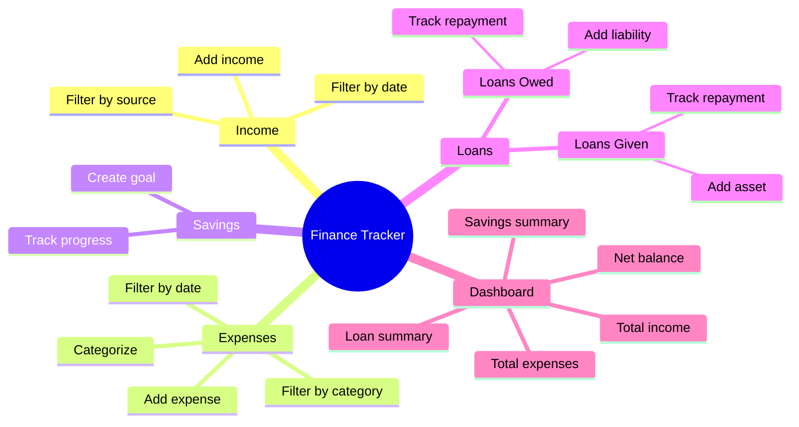
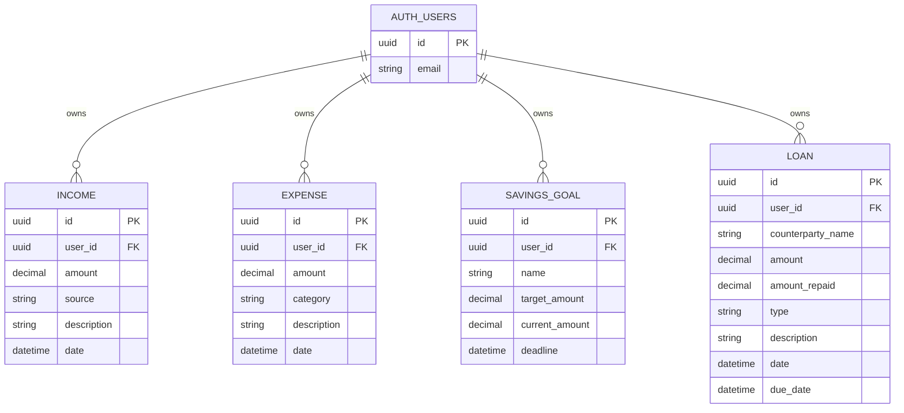
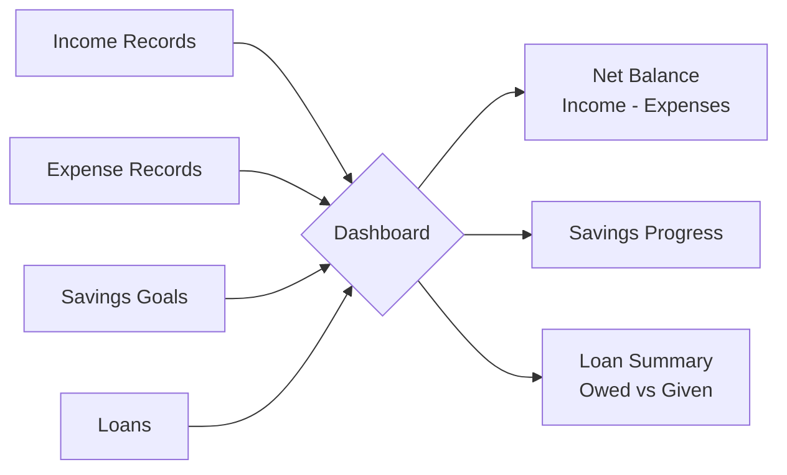
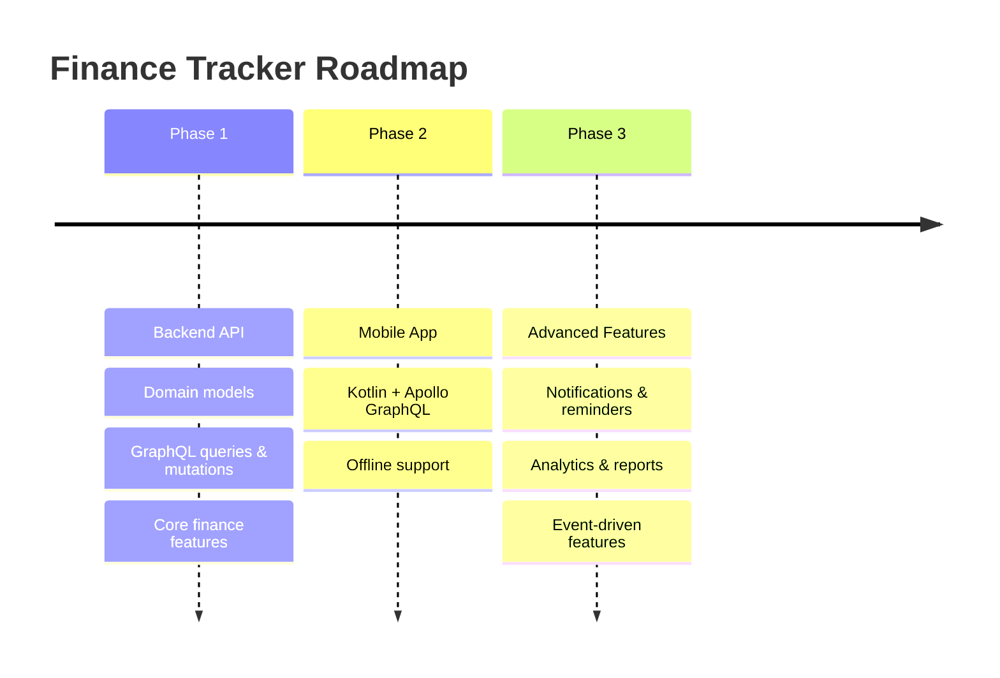

# 📋 Product Requirements Document (PRD)
## Finance Tracker — GraphQL + .NET + Kotlin

---

## 1. Overview

Finance Tracker is a personal finance management system that helps users take control of their money. It provides a structured way to record income, track expenses, manage savings goals, and monitor loans — all through a clean GraphQL API backed by Supabase (PostgreSQL + Auth).

---

## 2. Goals

- Give users a clear picture of their financial health
- Make it easy to record and categorize financial activity
- Track progress toward savings goals
- Monitor loan obligations and repayments

---

## 3. User Stories

### 🔐 Authentication
- As a user, I want to sign up with my email and password
- As a user, I want to log in and receive a JWT token to access my data
- As a user, I want my financial data to be private and only accessible to me

### 💰 Income
- As a user, I want to add an income record so I can track money I receive
- As a user, I want to filter income by date or source so I can review my earnings

### 💸 Expenses
- As a user, I want to add an expense so I can track where my money goes
- As a user, I want to categorize expenses so I can understand my spending patterns
- As a user, I want to filter expenses by date and category

### 🏦 Savings
- As a user, I want to create a savings goal so I can work toward a target
- As a user, I want to see my progress toward each savings goal

### 💳 Loans
- As a user, I want to record money I owe so I can track my liabilities
- As a user, I want to record money I lent so I can track what others owe me
- As a user, I want to see repayment progress for each loan

### 📊 Dashboard
- As a user, I want to see my total income, expenses, and net balance at a glance
- As a user, I want a summary of my savings and loan status

---

## 4. Feature Map

---

## 5. Core Entities

> `AUTH_USERS` represents `auth.users` — managed entirely by Supabase. We never create or modify it.  
> `user_id` on every table is a foreign key to `auth.users.id`.  
> `LoanType` is an enum: `Owed` (liability) | `Given` (asset)

---

## 6. Dashboard Summary

---

## 7. Out of Scope (MVP)

| Feature | Reason |
|---|---|
| Payment integrations | Complexity, out of MVP scope |
| Bank syncing | Requires third-party APIs |
| Notifications | Future phase |
| Advanced analytics | Future phase |
| Multi-user / shared accounts | Future phase |

---

## 8. Future Roadmap

---

## 9. Success Criteria

- Users can register and log in via Supabase Auth
- All GraphQL operations are protected — unauthenticated requests are rejected
- Each user can only access their own financial data
- All MVP features accessible via GraphQL API
- Clean, validated mutations with meaningful error responses
- Dashboard query returns accurate aggregated data
- Mobile app (Phase 2) can consume the API with no changes to the backend
