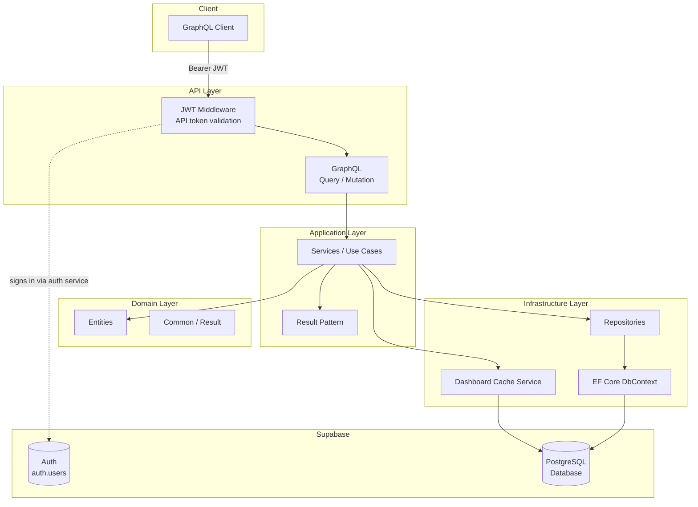
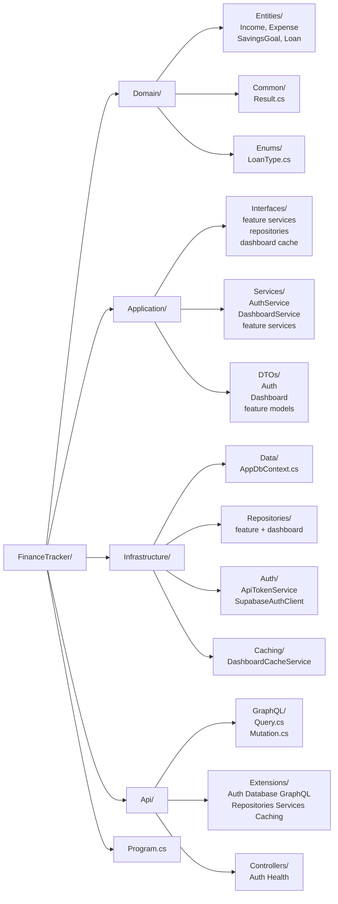
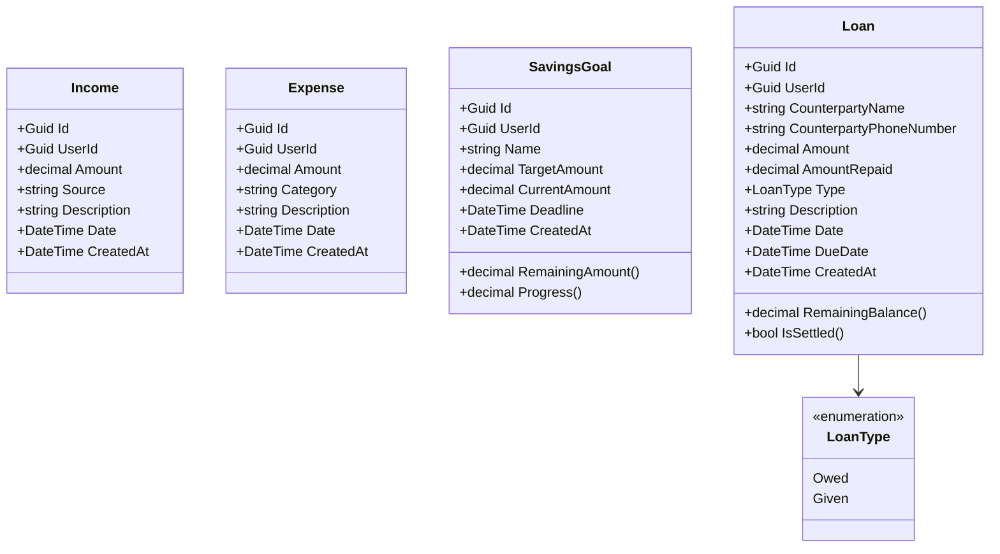
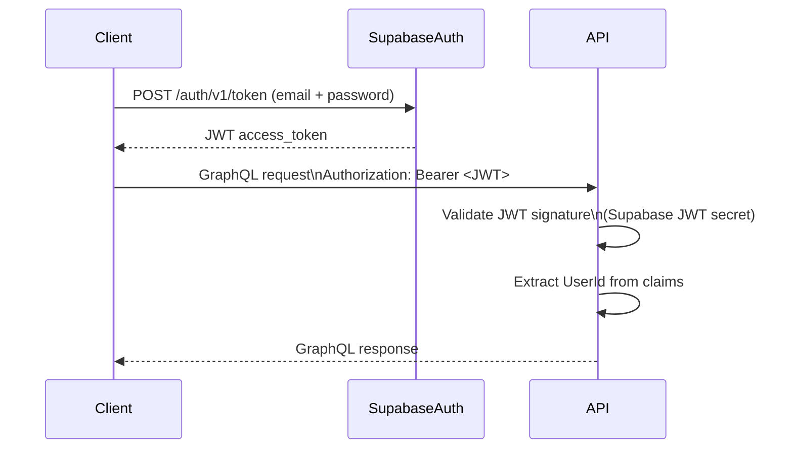
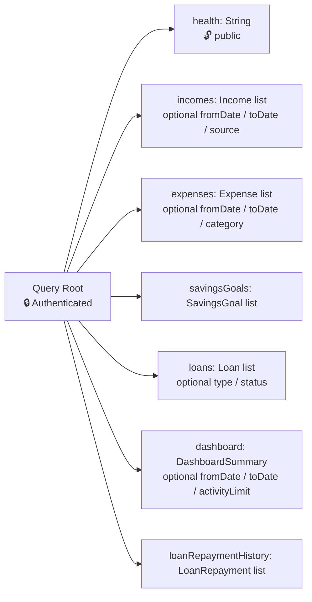
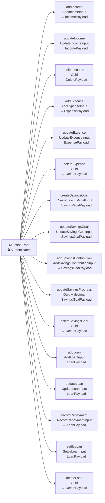
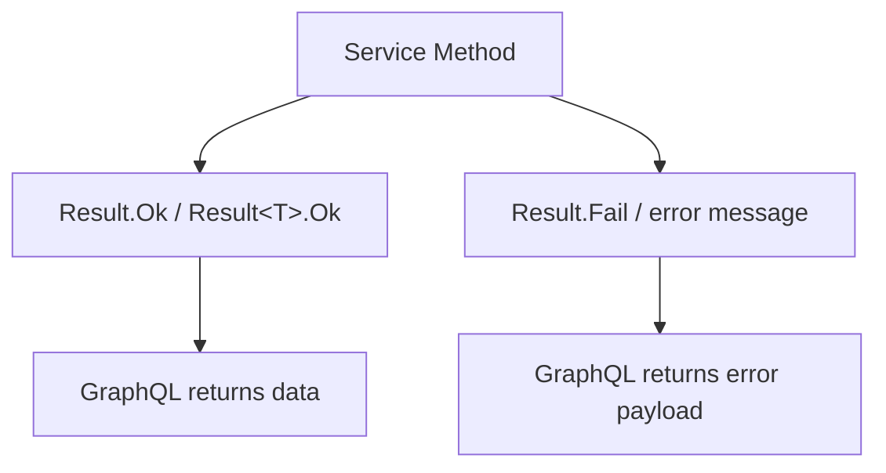
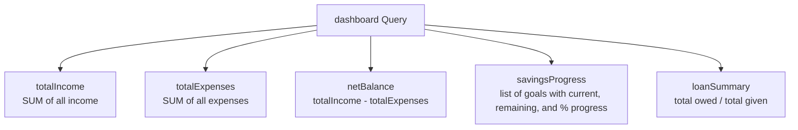
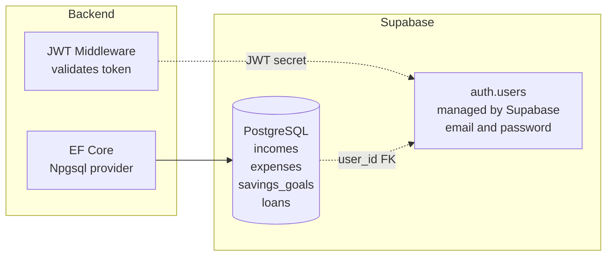
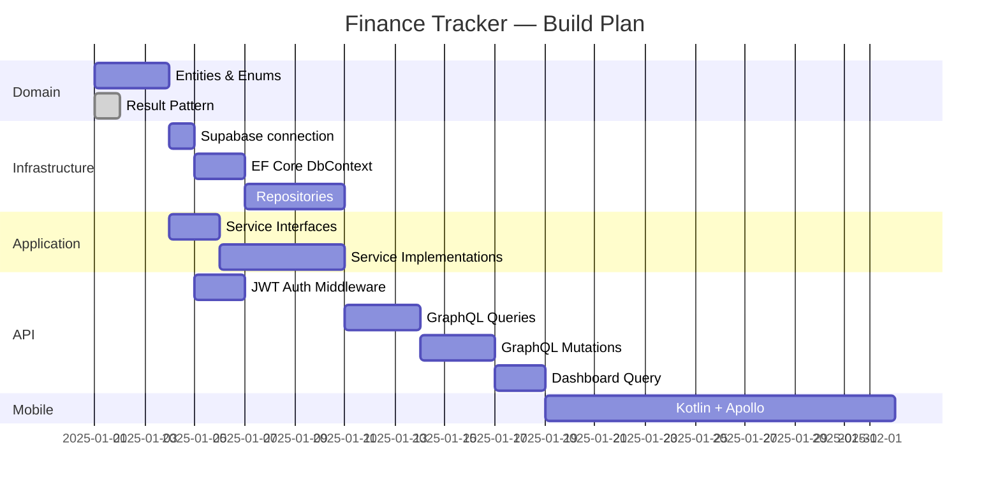

# 🛠️ Technical Requirements Document (TRD)
## Finance Tracker — GraphQL + .NET + Kotlin

---

## 1. Tech Stack

| Layer | Technology |
|---|---|
| API | .NET 10, Hot Chocolate 15 (GraphQL) |
| Architecture | Clean Architecture |
| Database | Supabase (PostgreSQL) |
| Auth | Supabase Auth (credential verification) + own JWT tokens |
| ORM | Entity Framework Core |
| Cache | Redis via `IDistributedCache` with in-memory fallback |
| Mobile | Kotlin + Apollo GraphQL (Phase 2) |
| Runtime | .NET 10 |

---

## 2. Architecture Overview



### Layer Responsibilities

| Layer | Responsibility |
|---|---|
| Domain | Core entities, enums, value objects, Result pattern |
| Application | Business logic, use cases, service interfaces, cache invalidation decisions |
| Infrastructure | EF Core DbContext, Supabase connection, repository implementations, Redis-backed cache implementation |
| API | GraphQL types, queries, mutations, JWT auth middleware — no business logic |

---

## 3. Project Structure



---

## 4. Domain Entities



> All entities carry `UserId` which maps to `auth.users.id` in Supabase.  
> Supabase Auth owns the user identity (email + password). We never create a users table.

---

## 5. GraphQL API Design

### Authentication Flow



### Queries



### Mutations



### Dashboard Read Strategy

The dashboard is implemented as a purpose-built read path rather than a naive composition of generic list queries.

Current characteristics:
- dedicated dashboard repository
- SQL-side totals and loan summary aggregation
- read-only EF queries with `AsNoTracking()`
- recent activity assembled from focused per-source reads
- Redis-backed cache for the final dashboard response
- cache invalidation triggered after successful dashboard-affecting writes

---

## 6. Result Pattern

All service methods return `Result<T>` or `Result` — no exceptions thrown for business logic failures.



---

## 7. Data Flow — Add Expense Example

```mermaid
sequenceDiagram
    participant Client
    participant JWT Middleware
    participant GraphQL
    participant ExpenseService
    participant Repository
    participant Supabase DB

    Client->>JWT Middleware: mutation addExpense(input)\nBearer <JWT>
    JWT Middleware->>JWT Middleware: Validate token\nExtract UserId
    JWT Middleware->>GraphQL: forward request + UserId
    GraphQL->>ExpenseService: AddExpenseAsync(input, userId)
    ExpenseService->>ExpenseService: Validate input
    ExpenseService->>Repository: SaveAsync(expense)
    Repository->>Supabase DB: INSERT
    Supabase DB-->>Repository: OK
    Repository-->>ExpenseService: expense
    ExpenseService-->>GraphQL: Result&lt;Expense&gt;.Ok(expense)
    GraphQL-->>Client: ExpensePayload { expense }
```

---

## 8. Dashboard Query



---

## 9. Error Handling Strategy

| Scenario | Handling |
|---|---|
| Missing / invalid JWT | 401 Unauthorized before reaching GraphQL |
| Invalid input | Return `Result.Fail` with descriptive message |
| Entity not found | Return `Result.Fail("Not found")` |
| Unauthorized data access | UserId scoping prevents cross-user access |
| Unexpected exception | Caught at GraphQL layer, generic error returned |
| Validation errors | Handled in service layer before DB access |

---

## 10. Supabase Integration



> We never create a users table. Supabase Auth manages `auth.users` entirely.  
> Our tables reference `auth.users.id` via `user_id` foreign keys.
> For this long-lived .NET backend, prefer a direct Postgres connection when possible, or the Supabase session pooler on port `5432`. Avoid the transaction pooler on port `6543` for normal EF Core / Npgsql traffic unless you have a specific reason to use transaction mode.

---

## 11. Development Phases


