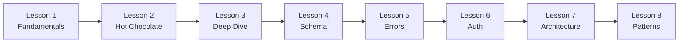

# GraphQL Lessons — Finance Tracker

A complete learning path from GraphQL fundamentals to real-world production patterns, built around this project.

---

## Lessons

| # | Title | What you learn |
|---|---|---|
| [1](./lesson-01-graphql-fundamentals.md) | GraphQL Fundamentals | What GraphQL is, queries, mutations, schema, types, resolvers |
| [2](./lesson-02-queries-and-mutations.md) | Queries and Mutations in Hot Chocolate | How C# maps to GraphQL, `[Service]`, `[Authorize]`, payloads |
| [3](./lesson-03-graphql-engineering-deep-dive.md) | Engineering Deep Dive | Single endpoint, execution engine, variables, fragments, N+1, introspection |
| [4](./lesson-04-schema-in-depth.md) | The Schema In Depth | SDL, type mapping, non-null, input vs output types, enums, deprecation |
| [5](./lesson-05-error-handling.md) | Error Handling | Three levels of errors, payload pattern, AppResult, partial success |
| [6](./lesson-06-authentication-and-security.md) | Authentication and Security | JWT, access tokens, UserId scoping, our own JWT |
| [7](./lesson-07-clean-architecture-and-graphql.md) | Clean Architecture and GraphQL | Four layers, dependency rule, thin resolvers, interfaces, DI |
| [8](./lesson-08-real-world-patterns.md) | Real World Patterns | 10 patterns used in this project with code examples |

---

## Learning Path



---

## Quick Reference

### How to send a GraphQL request
```
Method:  POST
URL:     http://localhost:8080/graphql
Headers: Content-Type: application/json
         Authorization: Bearer <token>   (for protected operations)
Body:    { "query": "{ incomes { id amount source } }" }
```

### How to sign in
```
Method:  POST
URL:     http://localhost:8080/api/auth/signin
Headers: Content-Type: application/json
Body:    { "email": "...", "password": "..." }
```

### How to check API health
```
Method:  GET
URL:     http://localhost:8080/health
```

### Success response shape
```json
{
  "data": {
    "addIncome": {
      "income": { "id": "...", "amount": 5000 },
      "errors": null
    }
  }
}
```

### Failure response shape
```json
{
  "data": {
    "addIncome": {
      "income": null,
      "errors": ["Amount must be greater than 0."]
    }
  }
}
```

### Auth error shape
```json
{
  "errors": [
    {
      "message": "The current user is not authorized to access this resource.",
      "extensions": { "code": "AUTH_NOT_AUTHENTICATED" }
    }
  ],
  "data": null
}
```
