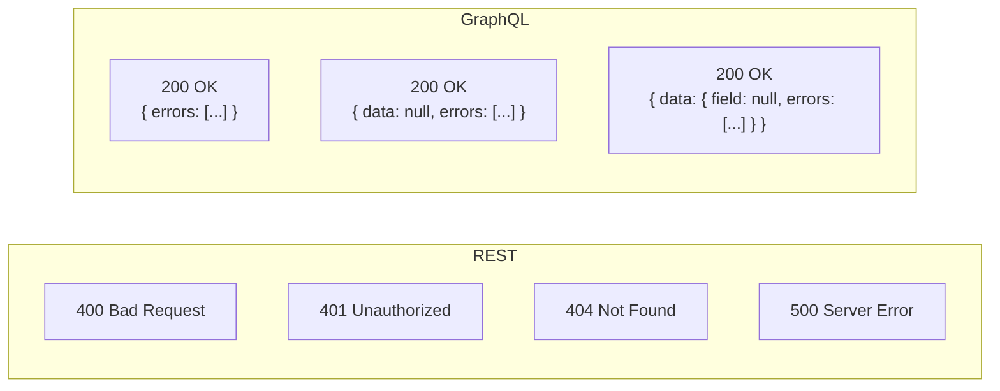
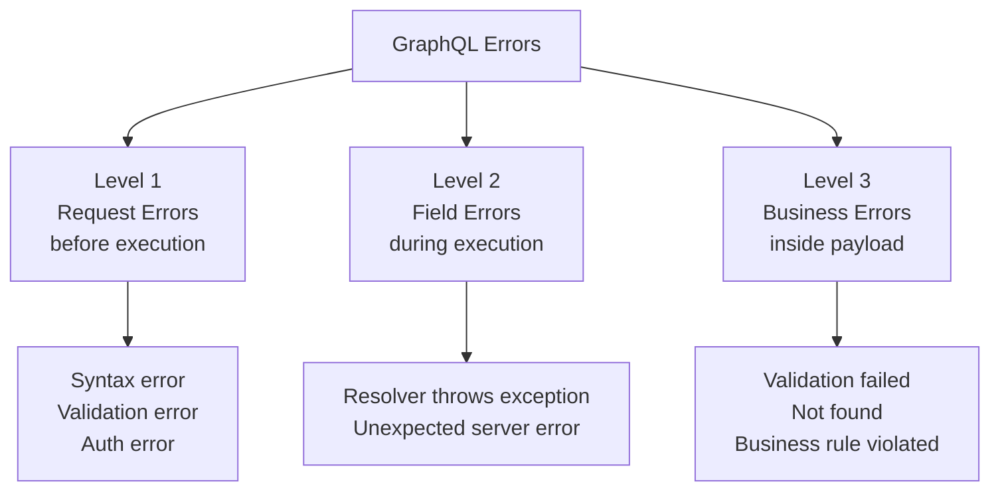
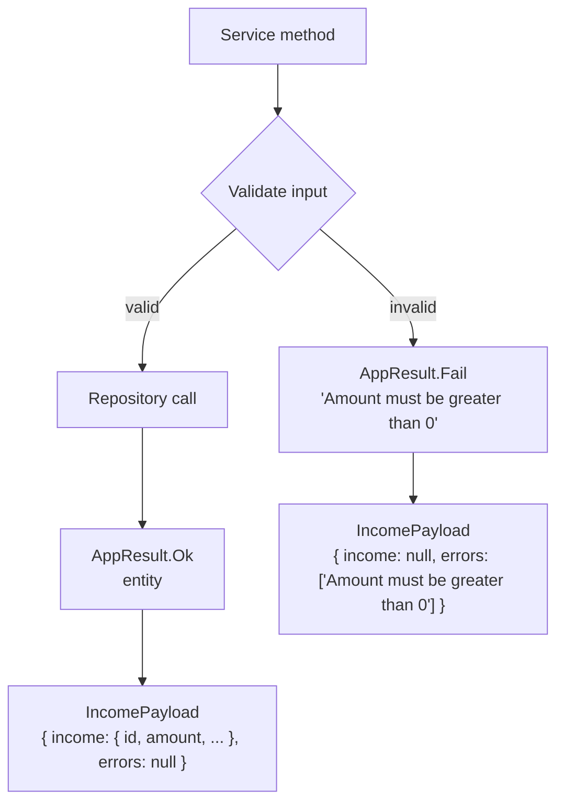
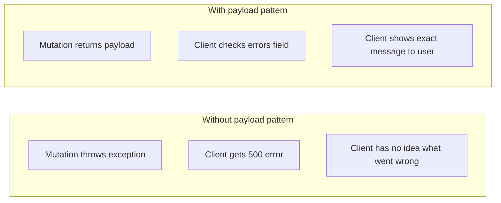
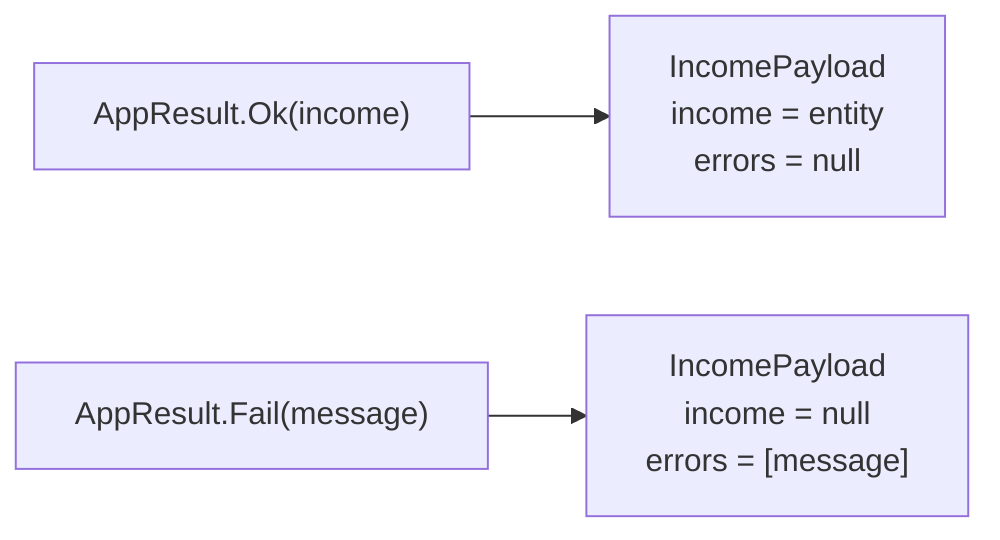
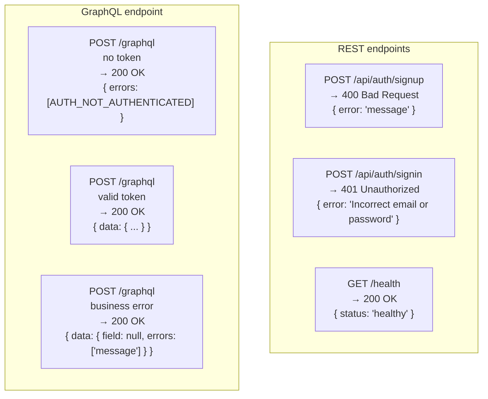

# Lesson 5 — Error Handling in GraphQL

## GraphQL Errors Are Different From REST

In REST, errors live in the HTTP status code:
- `400` — bad request
- `401` — unauthorized
- `404` — not found
- `500` — server error

In GraphQL, **HTTP is almost always `200`**. Errors live inside the response body.



This surprises developers coming from REST. The reason is that a single GraphQL request can partially succeed — some fields resolve correctly while others fail.

---

## The Three Levels of GraphQL Errors



---

## Level 1 — Request Errors

These happen **before any resolver runs**. The entire request fails.

### Syntax error
```graphql
{ incomes { id amount }   # missing closing brace
```
Response:
```json
{
  "errors": [
    {
      "message": "Expected Name, found <EOF>.",
      "locations": [{ "line": 1, "column": 28 }]
    }
  ]
}
```

### Validation error — field does not exist
```graphql
{ incomes { id bankBalance } }  # bankBalance does not exist
```
Response:
```json
{
  "errors": [
    {
      "message": "Cannot query field 'bankBalance' on type 'Income'.",
      "locations": [{ "line": 1, "column": 15 }]
    }
  ]
}
```

### Auth error — no JWT
```graphql
{ incomes { id amount } }  # no Authorization header
```
Response:
```json
{
  "errors": [
    {
      "message": "The current user is not authorized to access this resource.",
      "extensions": { "code": "AUTH_NOT_AUTHENTICATED" }
    }
  ],
  "data": null
}
```

---

## Level 2 — Field Errors

These happen **during resolver execution** — an unexpected exception is thrown.

```json
{
  "errors": [
    {
      "message": "Unexpected Execution Error",
      "extensions": {
        "code": "UNEXPECTED_EXECUTION_ERROR"
      }
    }
  ],
  "data": null
}
```

In Development mode (`ASPNETCORE_ENVIRONMENT=Development`) Hot Chocolate shows the full stack trace:

```json
{
  "errors": [
    {
      "message": "Unexpected Execution Error",
      "extensions": {
        "message": "Object reference not set to an instance of an object.",
        "stackTrace": "   at FinanceTracker.Api.GraphQL.Query..."
      }
    }
  ]
}
```

In Production, the stack trace is hidden for security.

---

## Level 3 — Business Errors (Our Pattern)

This is the pattern we use in this project. Business errors are **not exceptions** — they are expected outcomes returned inside the payload.



The client always gets a `200 OK`. The success or failure is inside the payload:

```json
// Success
{
  "data": {
    "addIncome": {
      "income": { "id": "...", "amount": 5000 },
      "errors": null
    }
  }
}

// Business failure
{
  "data": {
    "addIncome": {
      "income": null,
      "errors": ["Amount must be greater than 0."]
    }
  }
}
```

---

## Why We Use the Payload Pattern

The payload pattern keeps errors **predictable and typed**.



On Android with Apollo:

```kotlin
val result = apolloClient.mutation(AddIncomeMutation(input)).execute()

// Check the payload — never throws
if (result.data?.addIncome?.errors == null) {
    val income = result.data?.addIncome?.income
    showSuccess(income)
} else {
    val error = result.data?.addIncome?.errors?.first()
    showError(error)  // "Amount must be greater than 0."
}
```

---

## The `AppResult<T>` Pattern in This Project

Every service method returns `AppResult<T>` — never throws for business logic.

```csharp
// Service returns AppResult
public async Task<AppResult<Income>> AddAsync(AddIncomeInput input, Guid userId, ...)
{
    if (input.Amount <= 0)
    {
        return AppResult<Income>.Fail("Amount must be greater than 0.");
    }

    var income = new Income(userId, input.Amount, input.Source, input.Description, input.Date);
    await repository.AddAsync(income, ct);
    return AppResult<Income>.Ok(income);
}

// Resolver maps AppResult to payload
public async Task<IncomePayload> AddIncome(AddIncomeInput input, ...)
{
    var result = await service.AddAsync(input, userId, ct);

    return result.IsSuccess
        ? new IncomePayload(result.Value, null)
        : new IncomePayload(null, [result.Error!]);
}
```



---

## Error Codes in GraphQL Extensions

GraphQL errors can carry extra data in the `extensions` field. This is useful for the client to handle errors programmatically.

```json
{
  "errors": [
    {
      "message": "The current user is not authorized to access this resource.",
      "extensions": {
        "code": "AUTH_NOT_AUTHENTICATED"
      }
    }
  ]
}
```

Common Hot Chocolate error codes:

| Code | Meaning |
|---|---|
| `AUTH_NOT_AUTHENTICATED` | No valid JWT provided |
| `AUTH_NOT_AUTHORIZED` | JWT valid but user lacks permission |
| `UNEXPECTED_EXECUTION_ERROR` | Unhandled exception in resolver |
| `VALIDATION_ERROR` | Schema validation failed |

On Android, you can check the code:

```kotlin
val errorCode = result.errors?.first()?.extensions?.get("code")
when (errorCode) {
    "AUTH_NOT_AUTHENTICATED" -> navigateToLogin()
    else -> showGenericError()
}
```

---

## Partial Success — A Unique GraphQL Feature

In GraphQL, a single request can partially succeed. Some fields resolve, others fail.

```graphql
query {
  incomes { id amount }    # succeeds
  dashboard { netBalance } # fails — some service error
}
```

Response:
```json
{
  "data": {
    "incomes": [{ "id": "...", "amount": 5000 }],
    "dashboard": null
  },
  "errors": [
    {
      "message": "Unexpected Execution Error",
      "path": ["dashboard"]
    }
  ]
}
```

The `path` field tells you exactly which field failed. The client can still use the `incomes` data even though `dashboard` failed.

---

## REST Auth Errors vs GraphQL Auth Errors

In this project we have a hybrid:



REST uses HTTP status codes because those endpoints are simple and universal.
GraphQL always returns `200` because the error detail is richer inside the body.

---

## How to Handle Errors on the Client

### Android (Apollo)

```kotlin
val response = apolloClient.mutation(AddIncomeMutation(input)).execute()

when {
    // Network or server error
    response.hasErrors() && response.data == null -> {
        val code = response.errors?.first()?.extensions?.get("code")
        if (code == "AUTH_NOT_AUTHENTICATED") navigateToLogin()
        else showError("Something went wrong")
    }

    // Business error in payload
    response.data?.addIncome?.errors != null -> {
        val message = response.data?.addIncome?.errors?.first()
        showValidationError(message)
    }

    // Success
    else -> {
        val income = response.data?.addIncome?.income
        showSuccess(income)
    }
}
```

---

## Key Takeaways

| Concept | What it means |
|---|---|
| HTTP 200 always | GraphQL errors live in the body, not the status code |
| Level 1 errors | Request rejected before execution — syntax, validation, auth |
| Level 2 errors | Unexpected exception during resolver execution |
| Level 3 errors | Business failures returned in payload — our pattern |
| Payload pattern | Every mutation returns data or errors — never throws |
| `AppResult<T>` | Service layer result — maps to payload in resolver |
| `extensions.code` | Machine-readable error code for client logic |
| Partial success | Some fields can succeed while others fail in one request |
| `path` field | Tells you exactly which field in the query failed |
