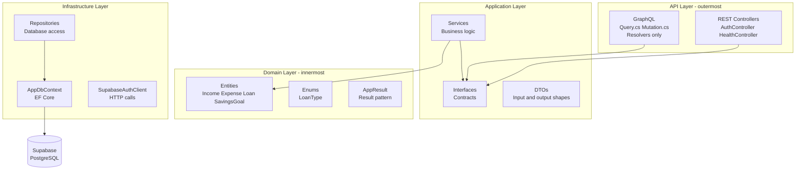
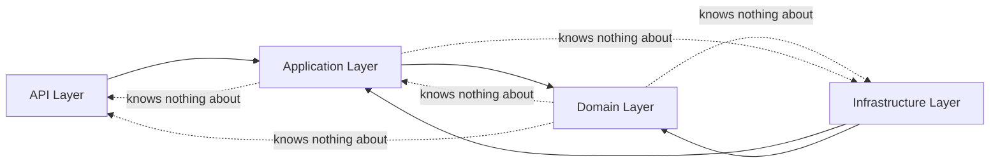
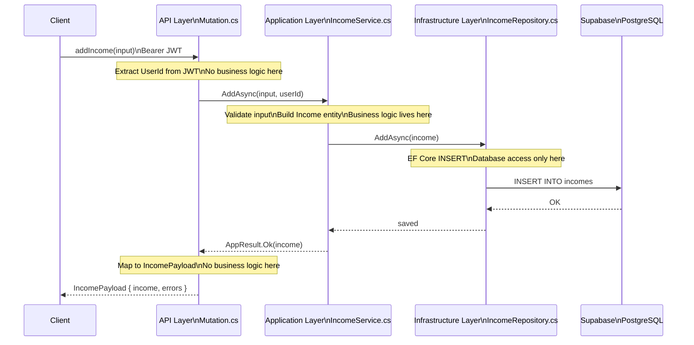
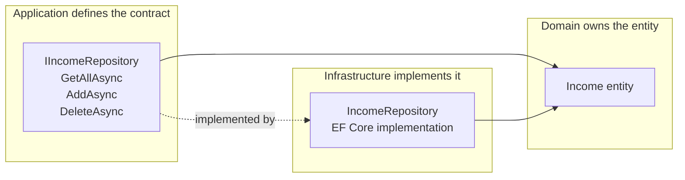
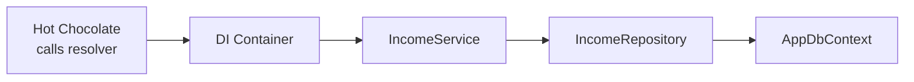
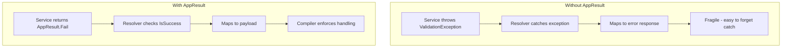
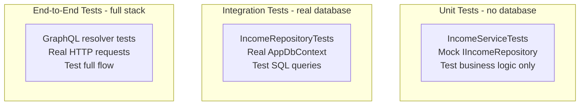

# Lesson 7 — Clean Architecture and How It Connects to GraphQL

## Why Architecture Matters

Without a clear architecture, a GraphQL API becomes a mess fast — resolvers talk directly to the database, business logic leaks into queries, and testing becomes impossible.

Clean Architecture solves this by enforcing strict rules about which layer can talk to which.

---

## The Four Layers



---

## The Dependency Rule

The most important rule in Clean Architecture:

> **Dependencies only point inward. Inner layers know nothing about outer layers.**



This means:
- `Income.cs` has zero imports — no EF Core, no GraphQL, no HTTP
- `IncomeService.cs` imports only Domain — no EF Core, no GraphQL
- `IncomeRepository.cs` imports Domain + Application interfaces — no GraphQL
- `Query.cs` imports Application interfaces — never Infrastructure directly

---

## How a Request Flows Through the Layers

Let's trace `addIncome` from the GraphQL request to the database and back.



---

## What Each Layer Is Responsible For

### Domain Layer — the rules of the business

```csharp
// Income.cs — pure business rules, zero dependencies
public sealed class Income
{
    public Guid Id { get; }
    public decimal Amount { get; }

    public Income(Guid userId, decimal amount, string source, ...)
    {
        // Business invariants enforced here
        if (amount <= 0)
            throw new ArgumentException("Amount must be greater than 0.");

        Id = Guid.NewGuid();
        Amount = amount;
    }
}
```

The domain layer answers: **"What are the rules of this business?"**

### Application Layer — the use cases

```csharp
// IncomeService.cs — orchestrates domain + repository
public async Task<AppResult<Income>> AddAsync(AddIncomeInput input, Guid userId, ...)
{
    // Validate input (service-level validation)
    if (input.Amount <= 0)
        return AppResult<Income>.Fail("Amount must be greater than 0.");

    if (input.Date > DateTime.UtcNow)
        return AppResult<Income>.Fail("Date cannot be in the future.");

    // Build domain entity (domain-level validation)
    var income = new Income(userId, input.Amount, input.Source, input.Description, input.Date);

    // Persist via repository interface
    await repository.AddAsync(income, ct);

    return AppResult<Income>.Ok(income);
}
```

The application layer answers: **"What can users do with this system?"**

### Infrastructure Layer — the technical details

```csharp
// IncomeRepository.cs — EF Core, database, SQL
public async Task AddAsync(Income income, CancellationToken ct)
{
    await db.Incomes.AddAsync(income, ct);
    await db.SaveChangesAsync(ct);
}
```

The infrastructure layer answers: **"How do we store and retrieve data?"**

### API Layer — the delivery mechanism

```csharp
// Mutation.cs — GraphQL resolver, thin as possible
[Authorize]
public async Task<IncomePayload> AddIncome(
    AddIncomeInput input,
    [Service] IIncomeService service,
    ClaimsPrincipal claimsPrincipal,
    CancellationToken ct)
{
    var userId = claimsPrincipal.GetUserId();
    var result = await service.AddAsync(input, userId, ct);

    return result.IsSuccess
        ? new IncomePayload(result.Value, null)
        : new IncomePayload(null, [result.Error!]);
}
```

The API layer answers: **"How do clients communicate with the system?"**

---

## Why Resolvers Must Be Thin

A resolver that does too much:

```csharp
// BAD — business logic in resolver
[Authorize]
public async Task<IncomePayload> AddIncome(AddIncomeInput input, ...)
{
    // Validation in resolver — wrong layer
    if (input.Amount <= 0)
        return new IncomePayload(null, ["Amount must be greater than 0."]);

    // Direct DB access in resolver — wrong layer
    var income = new Income(userId, input.Amount, input.Source, input.Description, input.Date);
    await db.Incomes.AddAsync(income);
    await db.SaveChangesAsync();

    return new IncomePayload(income, null);
}
```

Problems:
- Cannot test without a real database
- Cannot reuse logic from another endpoint
- Validation duplicated if you add a REST endpoint later
- Violates Single Responsibility

A resolver that is correctly thin:

```csharp
// GOOD — resolver only wires things together
[Authorize]
public async Task<IncomePayload> AddIncome(AddIncomeInput input, ...)
{
    var userId = claimsPrincipal.GetUserId();
    var result = await service.AddAsync(input, userId, ct);

    return result.IsSuccess
        ? new IncomePayload(result.Value, null)
        : new IncomePayload(null, [result.Error!]);
}
```

---

## Interfaces — The Bridge Between Layers

Interfaces are what allow the dependency rule to work. The Application layer defines what it needs. The Infrastructure layer provides it.



The service only knows about `IIncomeRepository`. It has no idea whether the data comes from PostgreSQL, SQLite, or an in-memory list. This is what makes unit testing possible — you swap the real repository for a mock.

---

## DI — Dependency Injection Wires It All Together

In `Program.cs` we register everything:

```csharp
// Repositories — Infrastructure implements Application interfaces
builder.Services.AddScoped<IIncomeRepository, IncomeRepository>();

// Services — Application implements Application interfaces
builder.Services.AddScoped<IIncomeService, IncomeService>();
```

When Hot Chocolate calls the `AddIncome` resolver, it asks the DI container for `IIncomeService`. The container provides `IncomeService`, which was constructed with `IIncomeRepository`, which was constructed with `AppDbContext`. The whole chain is assembled automatically.



---

## The AppResult Pattern — Errors Without Exceptions

Exceptions are for unexpected situations. Business failures are expected — they should be returned, not thrown.



```csharp
// AppResult forces the caller to handle both cases
public abstract class AppResultBase
{
    public string? Error { get; }
    public bool IsSuccess { get; }
    public bool IsFailure => !IsSuccess;
}

public sealed class AppResult<T> : AppResultBase
{
    public T? Value { get; }

    public static AppResult<T> Ok(T value) => ...;
    public static AppResult<T> Fail(string error) => ...;
}
```

---

## How This Architecture Enables Testing

Because of Clean Architecture, each layer can be tested independently:



Unit tests mock the repository:

```csharp
// No database needed — mock returns fake data
var mockRepo = new Mock<IIncomeRepository>();
mockRepo.Setup(r => r.AddAsync(It.IsAny<Income>(), default))
        .Returns(Task.CompletedTask);

var service = new IncomeService(mockRepo.Object);
var result = await service.AddAsync(new AddIncomeInput(-100, "Salary", "", DateTime.UtcNow), userId);

Assert.True(result.IsFailure);
Assert.Equal("Amount must be greater than 0.", result.Error);
```

---

## Key Takeaways

| Concept | What it means |
|---|---|
| Clean Architecture | Strict layer separation — dependencies point inward only |
| Domain layer | Pure business rules — zero external dependencies |
| Application layer | Use cases — orchestrates domain and repositories |
| Infrastructure layer | Technical details — EF Core, HTTP clients, database |
| API layer | Delivery mechanism — GraphQL resolvers, REST controllers |
| Thin resolvers | Resolvers only extract UserId, call service, map result |
| Interfaces | Bridge between layers — enable testing and swapping implementations |
| DI | Wires all layers together at startup |
| AppResult | Business failures returned, not thrown — compiler-enforced handling |
