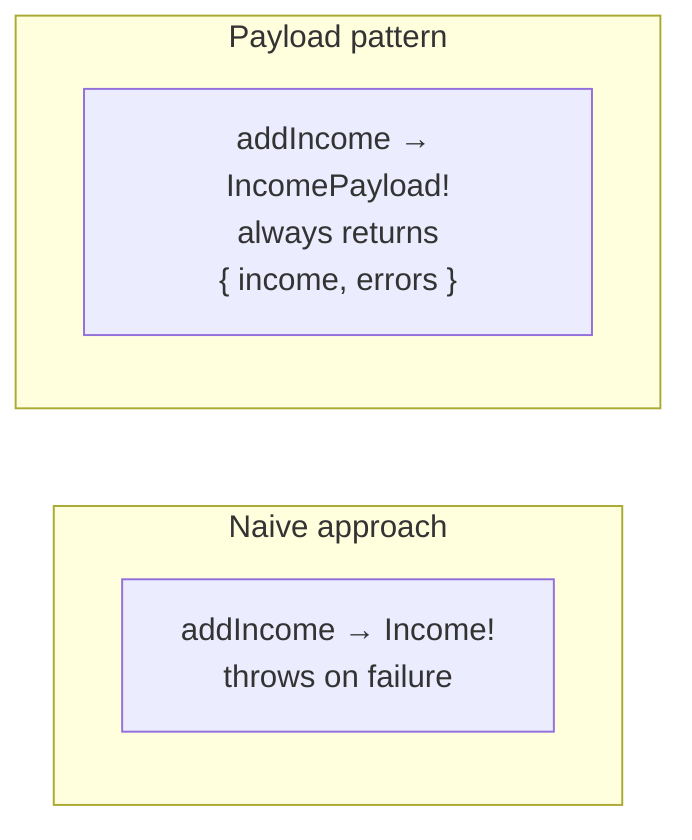
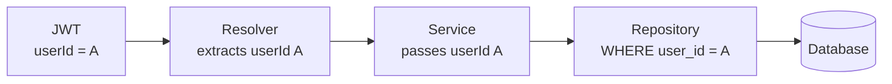
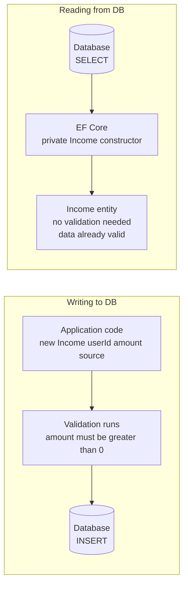
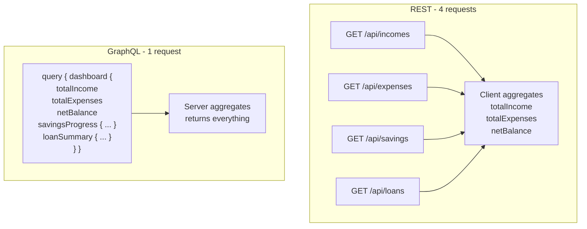

# Lesson 8 — Real World GraphQL Patterns

## Pattern 1 — The Payload Pattern

Every mutation returns a payload type — never the entity directly.



### Why not return the entity directly?

If you return `Income!` from a mutation and validation fails, you have two bad options:
- Return `null` — but the schema says non-null, so GraphQL throws an error
- Throw an exception — becomes an unhandled server error

The payload pattern solves this cleanly:

```graphql
type IncomePayload {
  income: Income      # null on failure
  errors: [String!]   # null on success
}
```

The client always gets a `200 OK` with a predictable shape. Either `income` is set or `errors` is set — never both, never neither.

---

## Pattern 2 — Input Types for Every Mutation

Never use individual arguments for mutations. Always use an input type.

```graphql
# Bad — individual arguments
mutation {
  addIncome(amount: 5000, source: "Salary", description: "...", date: "...")
}

# Good — input type
mutation {
  addIncome(input: { amount: 5000, source: "Salary", description: "...", date: "..." })
}
```

### Why input types?

- **Extensible** — add new fields to the input without breaking existing clients
- **Reusable** — same input type can be used in multiple mutations
- **Validated** — the schema validates the input shape before your code runs
- **Apollo codegen** — generates a single Kotlin/TypeScript class for the input

---

## Pattern 3 — UserId From Token, Never From Input

Never let the client tell you who they are. Extract the identity from the JWT.

```csharp
// BAD — client provides their own userId
public async Task<IncomePayload> AddIncome(
    AddIncomeInput input,
    Guid userId,          // ← client could send anyone's userId
    ...)

// GOOD — userId comes from the validated JWT
public async Task<IncomePayload> AddIncome(
    AddIncomeInput input,
    ClaimsPrincipal claimsPrincipal,  // ← from validated JWT
    ...)
{
    var userId = claimsPrincipal.GetUserId();  // ← extracted from token
}
```

This is a security rule. The JWT is signed with your secret — it cannot be forged. A request body can contain anything.

---

## Pattern 4 — Repository Scoping by UserId

Every repository method takes `userId` and filters by it. Cross-user data access is impossible at the database level.

```csharp
// Every query has WHERE user_id = @userId
public Task<List<Income>> GetAllAsync(Guid userId, CancellationToken ct) =>
    db.Incomes
      .Where(x => x.UserId == userId)
      .OrderByDescending(x => x.Date)
      .ToListAsync(ct);
```



Even if a bug in the resolver passed the wrong `userId`, the database query would return empty results — not another user's data.

---

## Pattern 5 — Computed Properties Ignored by EF Core

Domain entities have computed properties that are pure C# — they are never stored in the database.

```csharp
public sealed class SavingsGoal
{
    public decimal TargetAmount { get; }
    public decimal CurrentAmount { get; private set; }

    // Computed — not stored in DB
    public decimal RemainingAmount => TargetAmount - CurrentAmount;

    // Computed — not stored in DB
    public decimal Progress =>
        TargetAmount == 0 ? 0 : Math.Round(CurrentAmount / TargetAmount * 100, 2);
}
```

In `AppDbContext` we tell EF Core to ignore them:

```csharp
modelBuilder.Entity<SavingsGoal>(e =>
{
    e.Ignore(x => x.RemainingAmount); // ← not a column
    e.Ignore(x => x.Progress);  // ← not a column
});
```

But Hot Chocolate still exposes them in the GraphQL schema — the client can query `remainingAmount` and `progress` and gets the calculated values.

```graphql
query {
  savingsGoals {
    name
    targetAmount
    currentAmount
    remainingAmount
    progress    # calculated in C#, not stored in DB
  }
}
```

---

## Pattern 6 — CancellationToken Everywhere

Every async method accepts a `CancellationToken`. This allows the server to cancel in-flight database queries when the client disconnects.

```csharp
// Resolver passes ct down the chain
public async Task<List<Income>> Incomes(
    [Service] IIncomeService service,
    ClaimsPrincipal claimsPrincipal,
    CancellationToken cancellationToken)   // ← Hot Chocolate injects this
{
    var userId = claimsPrincipal.GetUserId();
    return (await service.GetAllAsync(userId, cancellationToken)).Value!;
}

// Service passes it to repository
public async Task<AppResult<List<Income>>> GetAllAsync(Guid userId, CancellationToken ct)
{
    var incomes = await repository.GetAllAsync(userId, ct);
    return AppResult<List<Income>>.Ok(incomes);
}

// Repository passes it to EF Core
public Task<List<Income>> GetAllAsync(Guid userId, CancellationToken ct) =>
    db.Incomes.Where(x => x.UserId == userId).ToListAsync(ct);
```

If the user closes the app mid-request, the database query is cancelled immediately — no wasted resources.

---

## Pattern 7 — Private Constructors for EF Core

Domain entities enforce invariants in their public constructor. But EF Core needs to create instances when reading from the database — without going through the public constructor.

```csharp
public sealed class Income
{
    public Guid Id { get; }
    public decimal Amount { get; }

    // EF Core uses this — bypasses validation
    private Income() { }

    // Application code uses this — enforces validation
    public Income(Guid userId, decimal amount, string source, ...)
    {
        if (amount <= 0)
            throw new ArgumentException("Amount must be greater than 0.");
        // ...
    }
}
```



---

## Pattern 8 — Extension Methods for Clean Code

Instead of repeating `claimsPrincipal.FindFirstValue("sub")` in every resolver, we extracted it into an extension method.

```csharp
// One place — Api/GraphQL/Helpers/ClaimsPrincipalExtensions.cs
public static Guid GetUserId(this ClaimsPrincipal principal)
{
    var value = principal.FindFirstValue("sub")
        ?? principal.FindFirstValue(ClaimTypes.NameIdentifier);

    return Guid.TryParse(value, out var id)
        ? id
        : throw new InvalidOperationException("UserId claim is missing or invalid.");
}

// Every resolver — one clean line
var userId = claimsPrincipal.GetUserId();
```

This is the DRY principle applied to GraphQL resolvers.

---

## Pattern 9 — Extension Methods for Program.cs

Instead of a 100-line `Program.cs`, each concern is extracted into its own extension method.

```csharp
// Clean Program.cs — reads like a table of contents
builder.Services.AddHttpContextAccessor();
builder.Services.AddControllers();
builder.Services.AddApiAuth(builder.Configuration);       // JWT
builder.Services.AddSupabaseClient(builder.Configuration); // Supabase HTTP
builder.Services.AddDatabase(builder.Configuration);       // EF Core
builder.Services.AddRepositories();                        // DI bindings
builder.Services.AddServices();                            // DI bindings
builder.Services.AddGraphQl(builder.Environment);          // Hot Chocolate
```

Each extension method has one responsibility. Adding a new concern means adding one line to `Program.cs` and one new extension file — existing files are never touched.

---

## Pattern 10 — The Dashboard Query

The dashboard is a perfect example of GraphQL's power over REST.



The server does the aggregation — the client gets exactly what it needs in one round trip. On mobile this is critical — fewer requests = faster screen load = less battery.

---

## Summary — Patterns Used in This Project

| Pattern | Where | Why |
|---|---|---|
| Payload pattern | Every mutation | Predictable success and failure shape |
| Input types | Every mutation argument | Extensible, validated, code-generated |
| UserId from JWT | Every protected resolver | Security — never trust client-provided identity |
| Repository scoping | Every DB query | Data isolation — cross-user access impossible |
| Computed properties | Domain entities | Business logic in domain, not database |
| CancellationToken | Every async method | Cancel in-flight queries on disconnect |
| Private EF constructor | All entities | EF Core hydration without bypassing validation |
| Extension methods | Resolvers, Program.cs | DRY — no repeated code |
| Thin resolvers | Query.cs, Mutation.cs | Single responsibility — wire only |
| Dashboard aggregation | Dashboard query | One request for all summary data |
