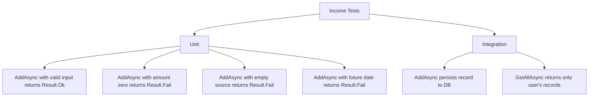
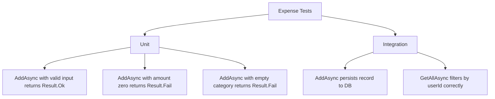
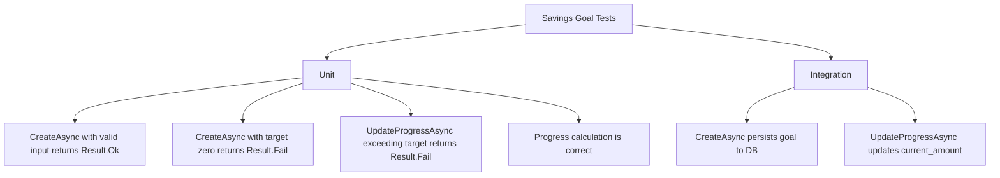
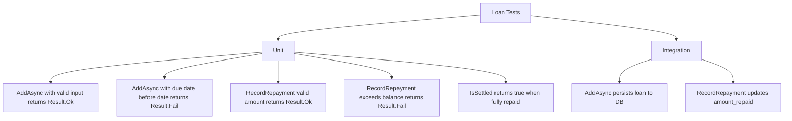
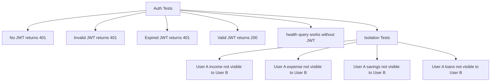
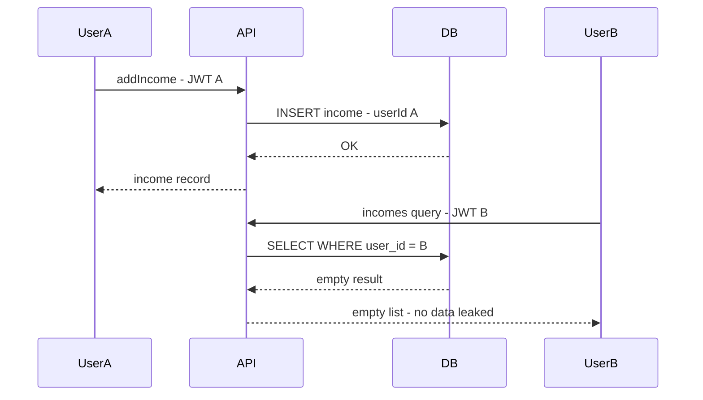
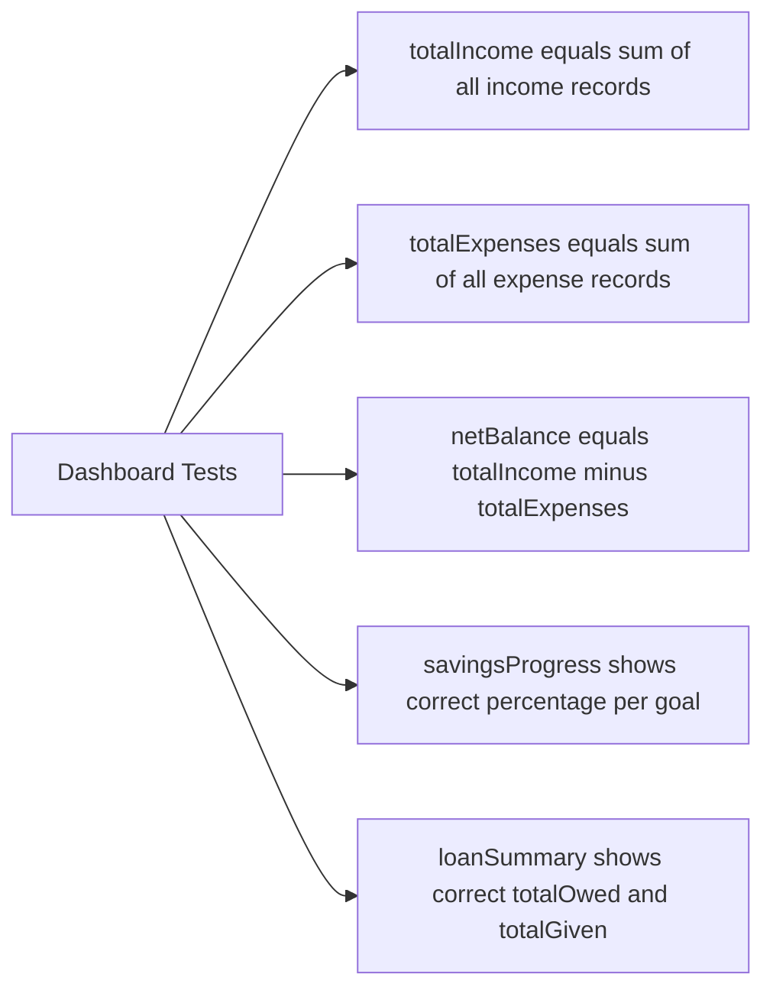

# Phase 5 — Testing and Hardening

## Goal
Validate the entire backend end-to-end. Cover every service's happy and failure paths, verify repository data scoping, test GraphQL resolvers, and confirm no data leaks between users.

## Test Plan
Use the detailed plan for what to test, where to test it, and exit criteria:
- `docs/test-plan.md`

---

## Checklist

- [ ] Unit tests for all service happy paths
- [ ] Unit tests for all service failure paths
- [ ] Repository integration tests against Supabase or local PostgreSQL
- [ ] GraphQL query and mutation integration tests
- [ ] Auth tests — unauthenticated requests rejected
- [ ] Cross-user data isolation verified for all features
- [ ] Dashboard aggregation tested with known data

---

## Test Project Structure

```
Tests/
├── Unit/
│   ├── Income/
│   │   └── IncomeServiceTests.cs
│   ├── Expense/
│   │   └── ExpenseServiceTests.cs
│   ├── Savings/
│   │   └── SavingsGoalServiceTests.cs
│   └── Loan/
│       └── LoanServiceTests.cs
└── Integration/
    ├── Income/
    │   └── IncomeRepositoryTests.cs
    ├── Expense/
    │   └── ExpenseRepositoryTests.cs
    ├── Savings/
    │   └── SavingsGoalRepositoryTests.cs
    ├── Loan/
    │   └── LoanRepositoryTests.cs
    ├── GraphQL/
    │   ├── IncomeResolverTests.cs
    │   ├── ExpenseResolverTests.cs
    │   ├── SavingsResolverTests.cs
    │   ├── LoanResolverTests.cs
    │   └── DashboardResolverTests.cs
    └── Auth/
        └── AuthorizationTests.cs
```

---

## Feature — Income Tests



---

## Feature — Expense Tests



---

## Feature — Savings Goal Tests



---

## Feature — Loan Tests



---

## Auth and Isolation Tests



---

## Data Isolation Sequence



---

## Dashboard Tests



---

## Test Tools

| Tool | Purpose |
|---|---|
| `xUnit` | Unit and integration test framework |
| `Moq` | Mock repository interfaces in unit tests |
| `Microsoft.AspNetCore.Mvc.Testing` | In-process GraphQL integration tests |
| Local PostgreSQL or Supabase | Integration test database |

---

## SOLID and Design Rules for Tests

| Rule | How it applies |
|---|---|
| Single Responsibility | Each test class covers one service or resolver only |
| DRY | Shared test data builders and fixtures — no copy-pasted setup |
| Arrange Act Assert | Every test follows AAA structure consistently |
| Isolation | Unit tests mock all dependencies — no real DB calls |

---

## Exit Criteria

- All unit tests pass
- All integration tests pass
- No cross-user data leakage in any feature
- Invalid inputs always produce `Result.Fail` with a message
- Unauthenticated requests always return `401`
- Dashboard returns correct aggregated values with known seed data
