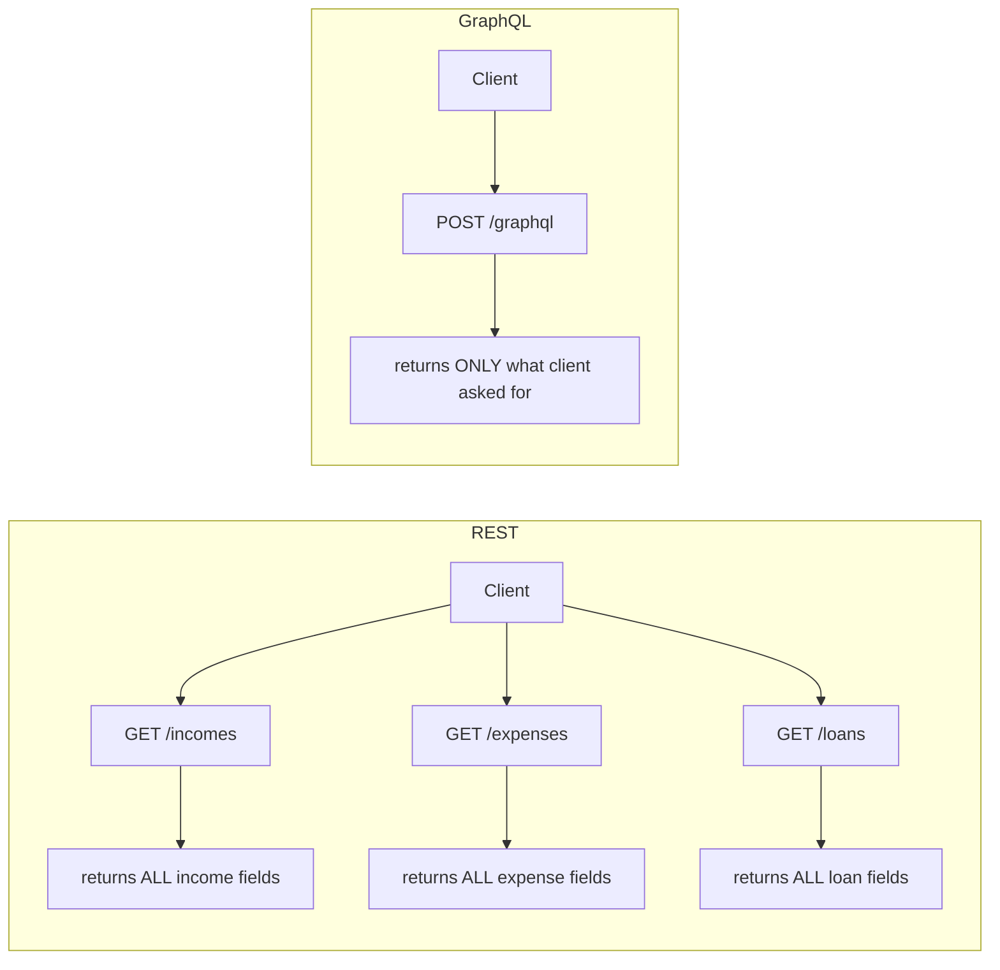
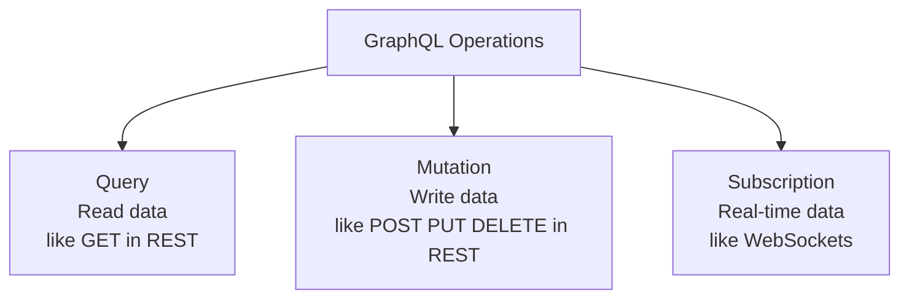
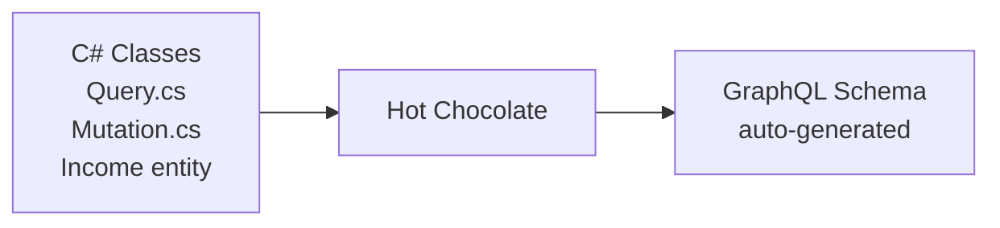
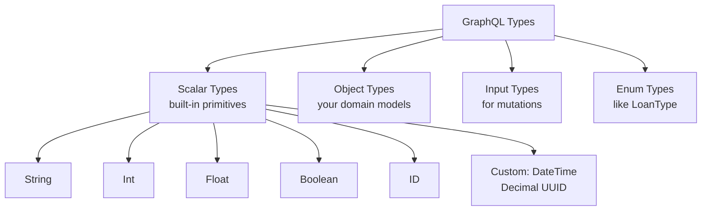
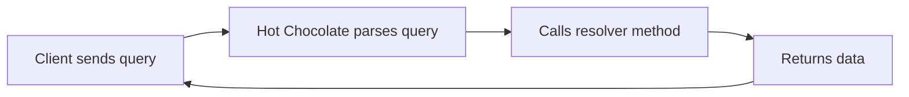
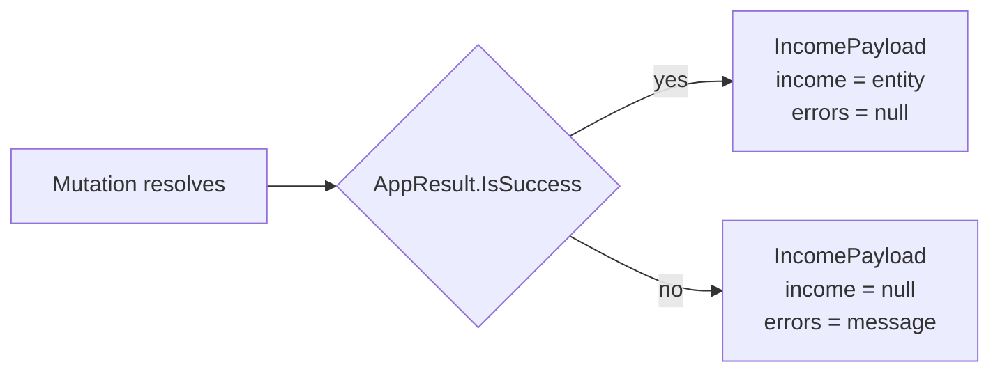
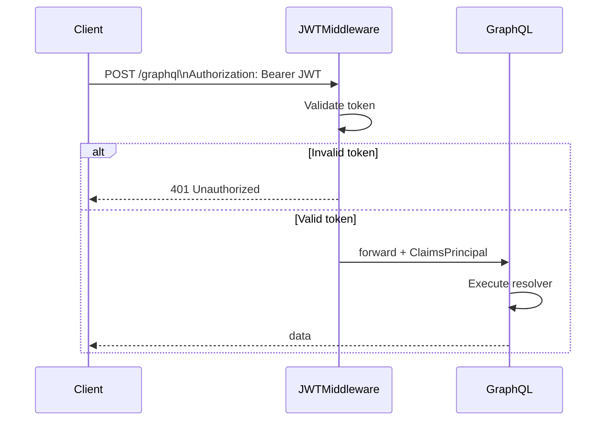
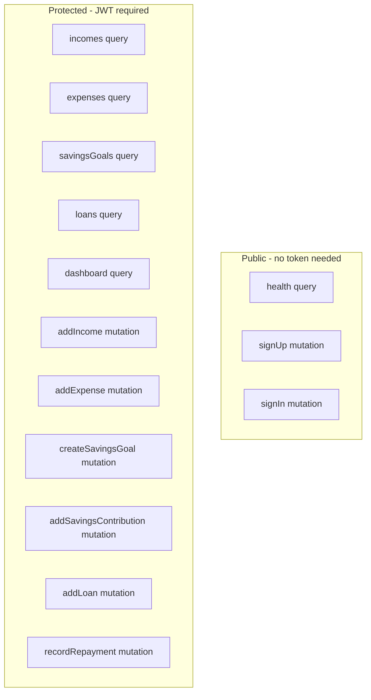

# Lesson 1 — GraphQL Fundamentals

## What is GraphQL?

GraphQL is a **query language for your API** and a **runtime for executing those queries**.

Instead of having many REST endpoints like:
```
GET  /api/incomes
POST /api/incomes
GET  /api/expenses
POST /api/loans/:id/repay
```

You have **one single endpoint**:
```
POST /graphql
```

The client decides exactly what data it wants by sending a query in the request body.

---

## REST vs GraphQL — The Core Difference



With REST, the server decides what data comes back.
With GraphQL, **the client decides**.

---

## The Three Operations

GraphQL has exactly three types of operations:



In this project we use **Query** and **Mutation** only.

---

## How a GraphQL Request Works

Every request is a POST to `/graphql` with a JSON body:

```json
{
  "query": "{ health }"
}
```

The server parses the query, executes it, and returns:

```json
{
  "data": {
    "health": "Finance Tracker API is running!"
  }
}
```

---

## Queries — Reading Data

A query asks for data. You specify exactly which fields you want.

```graphql
query {
  incomes {
    id
    amount
    source
    date
  }
}
```

The server returns only `id`, `amount`, `source`, and `date` — nothing else.
If you also wanted `description`, you add it to the query. This is called **no over-fetching**.

---

## Mutations — Writing Data

A mutation changes data. It looks like a query but uses the `mutation` keyword.

```graphql
mutation {
  addIncome(input: {
    amount: 5000
    source: "Salary"
    description: "Monthly salary"
    date: "2025-01-01T00:00:00Z"
  }) {
    income {
      id
      amount
      source
    }
    errors
  }
}
```

Notice the mutation returns data too — you get back the created income immediately.

---

## The Schema — The Contract

The schema is the **contract** between client and server. It defines every type, query, and mutation available.

In Hot Chocolate (.NET), the schema is **generated automatically** from your C# classes.



The generated schema looks like this:

```graphql
type Query {
  health: String!
  incomes(fromDate: DateTime, toDate: DateTime, source: String): [Income!]!
  expenses(fromDate: DateTime, toDate: DateTime, category: String): [Expense!]!
  loans(type: LoanType): [Loan!]!
}

type Mutation {
  signUp(input: SignUpInput!): SignUpPayloadResult!
  signIn(input: SignInInput!): SignInPayloadResult!
  addIncome(input: AddIncomeInput!): IncomePayload!
  addSavingsContribution(input: AddSavingsContributionInput!): SavingsGoalPayload!
}

type Income {
  id: ID!
  amount: Decimal!
  source: String!
  date: DateTime!
}
```

---

## Types in GraphQL



### Non-Null and Lists

- `String` — nullable string
- `String!` — non-null string (required)
- `[Income]` — list of nullable incomes
- `[Income!]!` — non-null list of non-null incomes

In Hot Chocolate, C# value types (`int`, `decimal`, `Guid`) map to non-null automatically.
C# reference types (`string`, classes) are nullable by default unless you configure otherwise.

---

## Resolvers — The Heart of GraphQL

A **resolver** is a function that returns the data for a field.

In Hot Chocolate, every public method on `Query` or `Mutation` is a resolver.

```csharp
public sealed class Query
{
    // This is a resolver for the "health" field
    public string Health() => "Finance Tracker API is running!";

    // This is a resolver for the "incomes" field
    [Authorize]
    public async Task<List<Income>> Incomes(
        DateTime? fromDate,
        DateTime? toDate,
        string? source,
        [Service] IIncomeService service,
        ClaimsPrincipal claimsPrincipal,
        CancellationToken cancellationToken)
    {
        var userId = claimsPrincipal.GetUserId();
        var result = await service.GetAllAsync(userId, cancellationToken);

        return result.Value!
            .Where(x => !fromDate.HasValue || x.Date >= fromDate.Value)
            .Where(x => !toDate.HasValue || x.Date <= toDate.Value)
            .Where(x => string.IsNullOrWhiteSpace(source) || x.Source == source)
            .ToList();
    }
}
```



---

## Arguments and Input Types

Queries can accept arguments for filtering:

```graphql
query {
  incomes(fromDate: "2025-01-01T00:00:00Z", source: "Salary") {
    id
    amount
    source
    date
  }
  loans(type: Owed) {
    id
    counterpartyName
    remainingBalance
  }
}
```

Mutations use **Input Types** — dedicated objects for write operations:

```graphql
input AddIncomeInput {
  amount: Decimal!
  source: String!
  description: String!
  date: DateTime!
}
```

In C#, these map directly to your DTO records:

```csharp
public sealed record AddIncomeInput(
    decimal Amount,
    string Source,
    string Description,
    DateTime Date);
```

---

## Payloads — The Mutation Response Pattern

A best practice in GraphQL is to return a **payload type** from every mutation instead of the entity directly. This lets you return either data or errors cleanly.

```graphql
type IncomePayload {
  income: Income        # null if failed
  errors: [String!]     # null if succeeded
  message: String       # optional success message
}
```

In our project every mutation follows this pattern:



---

## When To Use These Concepts

- Use a plain query like `dashboard` when the client only needs to read data and nothing should change in the database.
- Use query arguments like `fromDate`, `toDate`, `source`, and `type` when the client wants a narrower slice of data without creating new endpoints.
- Use an enum argument like `LoanType` when the client should choose from a fixed set of valid values such as `Owed` or `Given`.
- Use a mutation payload with `errors` and `message` when the operation can fail for business reasons and the client needs a predictable response shape.
- Use the public `health` query when you want a simple connectivity check from Postman, Banana Cake Pop, or a deployment smoke test.

---

## Authentication in GraphQL

GraphQL itself has no built-in auth. We use:

1. **JWT Bearer middleware** — validates the token before the request reaches GraphQL
2. **`[Authorize]` attribute** — marks a resolver as protected



The `ClaimsPrincipal` is injected into the resolver automatically by Hot Chocolate.
We extract the `UserId` from the `sub` claim — this is the Supabase Auth user UUID.

---

## How This Project Uses GraphQL



---

## Key Takeaways

| Concept | What it means |
|---|---|
| Single endpoint | Everything goes through `POST /graphql` |
| Query | Read data — client picks the fields |
| Mutation | Write data — returns a payload |
| Resolver | The C# method that handles a field |
| Schema | Auto-generated contract from C# classes |
| Input type | DTO used as mutation argument |
| Payload type | Mutation response wrapping data or errors |
| `[Authorize]` | Protects a resolver — requires valid JWT |
| `ClaimsPrincipal` | Injected by Hot Chocolate — contains UserId |

---

## Next Lesson

**Lesson 2 — Implementing Queries and Mutations in Hot Chocolate**
We will implement all resolvers for this project and see exactly how Hot Chocolate maps C# to GraphQL schema.
