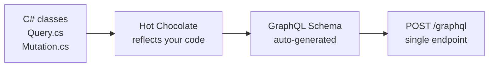
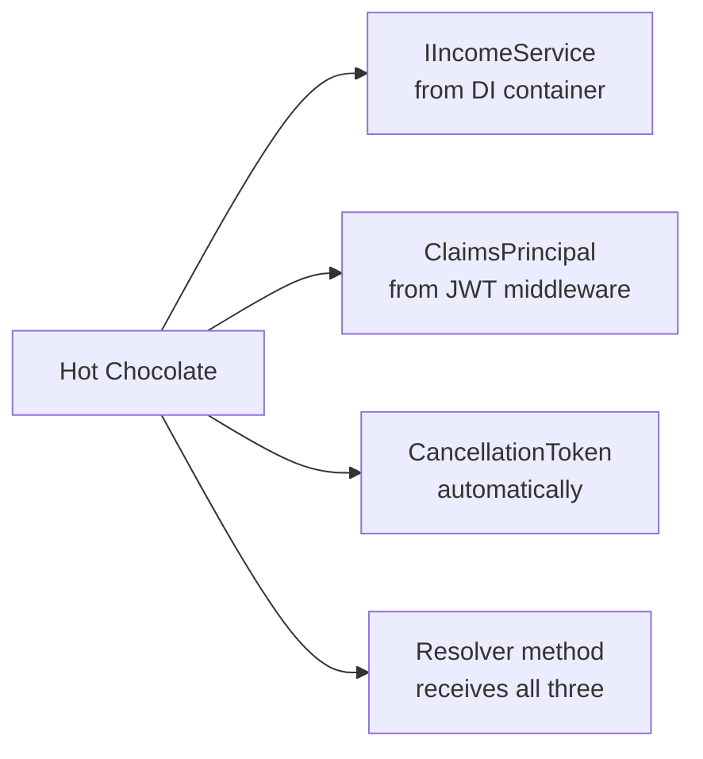
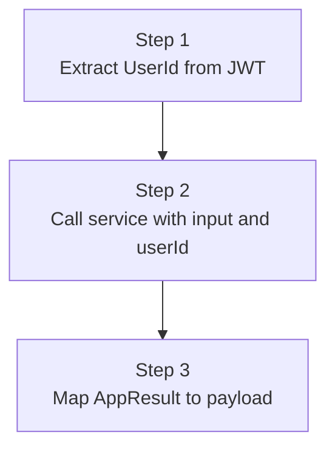

# Lesson 2 — Queries and Mutations in Hot Chocolate

## How Hot Chocolate Works

Hot Chocolate is a .NET GraphQL server. It reads your C# classes and **automatically generates the GraphQL schema** from them.



You never write `.graphql` schema files manually. Your C# **is** the schema.

---

## Registering Query and Mutation

In `Program.cs` we register the root types:

```csharp
builder.Services
    .AddGraphQLServer()
    .AddQueryType<Query>()
    .AddMutationType<Mutation>()
    .AddAuthorizationCore();
```

Hot Chocolate scans `Query` and `Mutation` and turns every public method into a GraphQL field.

---

## How a Resolver Method Maps to GraphQL

Take this C# method:

```csharp
public string Health() => "Finance Tracker API is running!";
```

Hot Chocolate generates this GraphQL field:

```graphql
type Query {
  health: String!
}
```

Rules:
- Method name → field name (camelCase automatically)
- Return type → GraphQL type
- Parameters → arguments or injected services

---

## Service Injection with `[Service]`

In REST controllers you inject services via the constructor.
In Hot Chocolate resolvers you inject them **per method** using `[Service]`:

```csharp
[Authorize]
public async Task<List<Income>> Incomes(
    DateTime? fromDate,                   // GraphQL argument
    DateTime? toDate,                     // GraphQL argument
    string? source,                       // GraphQL argument
    [Service] IIncomeService service,       // injected from DI
    ClaimsPrincipal claimsPrincipal,        // injected by Hot Chocolate
    CancellationToken cancellationToken)    // injected automatically
{
    var userId = claimsPrincipal.GetUserId();
    var result = await service.GetAllAsync(userId, cancellationToken);
    return result.Value!;
}
```



This is called **resolver-level injection** — each resolver only gets what it needs (ISP).

---

## The `[Authorize]` Attribute

Adding `[Authorize]` to a resolver tells Hot Chocolate to reject the request if no valid JWT is present.

```csharp
[Authorize]                    // protected — JWT required
public async Task<List<Income>> Incomes(...) { }

public string Health() => ...; // public — no JWT needed
```

Generated schema reflects this:

```graphql
type Query {
  health: String!              # anyone can call this
  incomes: [Income!]!          # requires authentication
}
```

---

## Input Types — How DTOs Become GraphQL Inputs

Your C# record:

```csharp
public sealed record AddIncomeInput(
    decimal Amount,
    string Source,
    string Description,
    DateTime Date);
```

Hot Chocolate generates:

```graphql
input AddIncomeInput {
  amount: Decimal!
  source: String!
  description: String!
  date: DateTime!
}
```

The mutation method receives it directly as a parameter:

```csharp
public async Task<IncomePayload> AddIncome(
    AddIncomeInput input,       // Hot Chocolate maps the GraphQL input to this
    [Service] IIncomeService service,
    ...)
```

---

## Payload Types — The Mutation Response Pattern

Every mutation in this project returns a **payload** — never the entity directly.

```csharp
public sealed record IncomePayload(
    Income? Income,
    IReadOnlyList<string>? Errors,
    string? Message);
```

Generated GraphQL:

```graphql
type IncomePayload {
  income: Income
  errors: [String!]
  message: String
}
```

Why? Because mutations can fail. The payload lets the client check:

```graphql
mutation {
  addIncome(input: { amount: 5000, source: "Salary", description: "", date: "2025-01-01T00:00:00Z" }) {
    income {
      id
      amount
    }
    errors
  }
}
```

If it succeeds:
```json
{ "data": { "addIncome": { "income": { "id": "...", "amount": 5000 }, "errors": null } } }
```

If it fails:
```json
{ "data": { "addIncome": { "income": null, "errors": ["Amount must be greater than 0."] } } }
```

---

## The Resolver Pattern in This Project

Every protected resolver follows the same 3-step pattern:



In code:

```csharp
[Authorize]
public async Task<IncomePayload> AddIncome(
    AddIncomeInput input,
    [Service] IIncomeService service,
    ClaimsPrincipal claimsPrincipal,
    CancellationToken cancellationToken)
{
    // Step 1 — extract UserId
    var userId = claimsPrincipal.GetUserId();

    // Step 2 — call service
    var result = await service.AddAsync(input, userId, cancellationToken);

    // Step 3 — map to payload
    return result.IsSuccess
        ? new IncomePayload(result.Value, null)
        : new IncomePayload(null, [result.Error!]);
}
```

The resolver has **zero business logic** — it only wires things together.

---

## DRY — The `GetUserId()` Extension

Every protected resolver needs the `UserId`. Instead of repeating the extraction logic everywhere, we extracted it into one place:

```csharp
// Api/GraphQL/Helpers/ClaimsPrincipalExtensions.cs
public static Guid GetUserId(this ClaimsPrincipal principal)
{
    var value = principal.FindFirstValue("sub")
        ?? principal.FindFirstValue(ClaimTypes.NameIdentifier);

    return Guid.TryParse(value, out var id)
        ? id
        : throw new InvalidOperationException("UserId claim is missing or invalid.");
}
```

Every resolver calls `claimsPrincipal.GetUserId()` — one line, no duplication.

---

## The Dashboard Query — Aggregation

The dashboard query calls **multiple services** and aggregates the results:

```csharp
[Authorize]
public async Task<DashboardSummary> Dashboard(
    [Service] IIncomeService incomeService,
    [Service] IExpenseService expenseService,
    [Service] ISavingsGoalService savingsService,
    [Service] ILoanService loanService,
    ClaimsPrincipal claimsPrincipal,
    CancellationToken cancellationToken)
{
    var userId = claimsPrincipal.GetUserId();

    var incomes = (await incomeService.GetAllAsync(userId, cancellationToken)).Value!;
    var expenses = (await expenseService.GetAllAsync(userId, cancellationToken)).Value!;
    var totalIncome = incomes.Sum(x => x.Amount);
    var totalExpenses = expenses.Sum(x => x.Amount);
    // ...

    return new DashboardSummary(
        TotalIncome:   totalIncome,
        TotalExpenses: totalExpenses,
        NetBalance:    totalIncome - totalExpenses,
        ...);
}
```

The client gets everything in one request:

```graphql
query {
  dashboard {
    totalIncome
    totalExpenses
    netBalance
    savingsProgress {
      name
      remainingAmount
      progress
    }
    loanSummary {
      totalOwed
      totalGiven
    }
  }
}
```

This is one of GraphQL's biggest advantages over REST — **one request, all the data you need**.

---

## Calling the API — Examples

### Sign Up
```graphql
mutation {
  signUp(input: { email: "user@example.com", password: "password123" }) {
    message
    errors
  }
}
```

### Sign In
```graphql
mutation {
  signIn(input: { email: "user@example.com", password: "password123" }) {
    signIn { accessToken tokenType }
    errors
  }
}
```

### Add Income (with JWT in header)
```graphql
mutation {
  addIncome(input: {
    amount: 5000
    source: "Salary"
    description: "Monthly salary"
    date: "2025-01-15T00:00:00Z"
  }) {
    income { id amount source date }
    errors
  }
}
```

### Get Dashboard
```graphql
query {
  dashboard {
    totalIncome
    totalExpenses
    netBalance
    loanSummary { totalOwed totalGiven }
  }
}
```

### Filter Income By Date And Source
```graphql
query {
  incomes(fromDate: "2025-01-01T00:00:00Z", toDate: "2025-12-31T23:59:59Z", source: "Salary") {
    id
    amount
    source
    date
  }
}
```

### Fetch Two Loan Views In One Request
```graphql
query {
  owed: loans(type: OWED) {
    id
    counterpartyName
    remainingBalance
  }
  given: loans(type: GIVEN) {
    id
    counterpartyName
    remainingBalance
  }
}
```

### Correct A Loan Amount After A Typo
```graphql
mutation {
  updateLoan(input: {
    id: "LOAN_ID"
    counterpartyName: "John Smith"
    amount: 2500.00
    description: "Corrected principal amount"
    dueDate: "2025-09-01T00:00:00Z"
  }) {
    loan {
      id
      amount
      amountRepaid
      remainingBalance
    }
    message
    errors
  }
}
```

---

## When To Use Each Pattern

- Use resolver arguments when you want flexible filtering without creating separate queries like `salaryIncomes`, `groceryExpenses`, and `owedLoans`.
- Use `[Service]` injection when the resolver needs application logic such as validation, persistence, or aggregation.
- Use `ClaimsPrincipal` when the result must be scoped to the authenticated user instead of trusting a client-supplied `userId`.
- Use payload types when the client should always receive a stable shape with either data or friendly validation errors.
- Use a composed query like `dashboard` when the UI needs totals, savings progress, remaining amounts, and loan summaries in one round trip.

---

## Key Takeaways

| Concept | How it works in this project |
|---|---|
| Root types | `Query` and `Mutation` classes registered in `Program.cs` |
| Resolver | Every public method on `Query` or `Mutation` |
| `[Service]` | Injects a service from DI into a resolver |
| `ClaimsPrincipal` | Injected automatically — holds the JWT claims |
| `[Authorize]` | Protects a resolver — rejects requests without JWT |
| Input type | C# record → GraphQL `input` type automatically |
| Payload type | C# record wrapping entity + errors + optional message |
| `GetUserId()` | Extension method — DRY UserId extraction |
| Dashboard | One query aggregating data from 4 services |

---

## Next Lesson

**Lesson 3 — GraphQL Engineering Deep Dive**
We’ll go one level deeper into execution, variables, aliases, introspection, and why GraphQL fits a client like this finance app so well.
