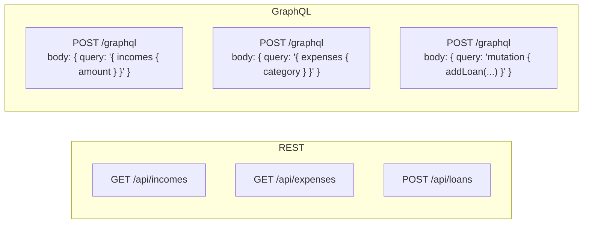
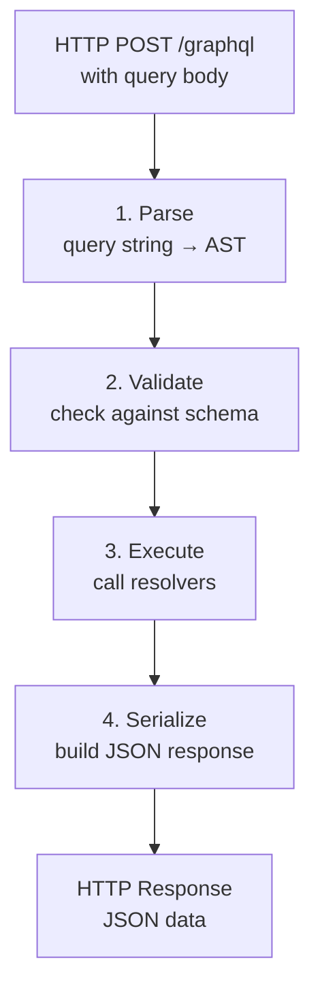
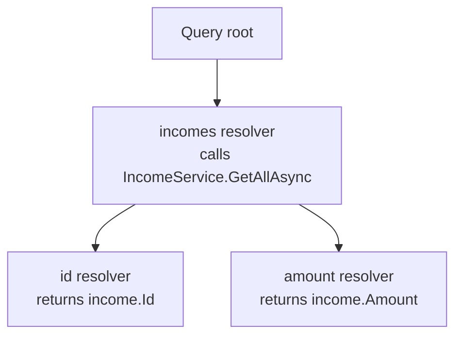
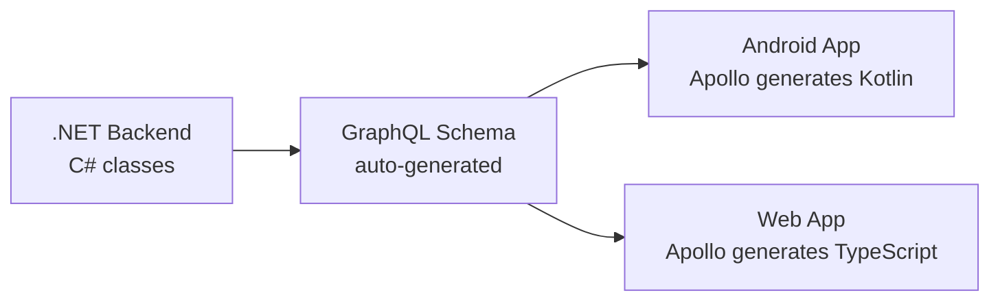
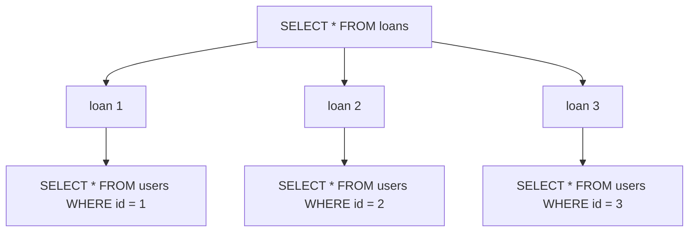
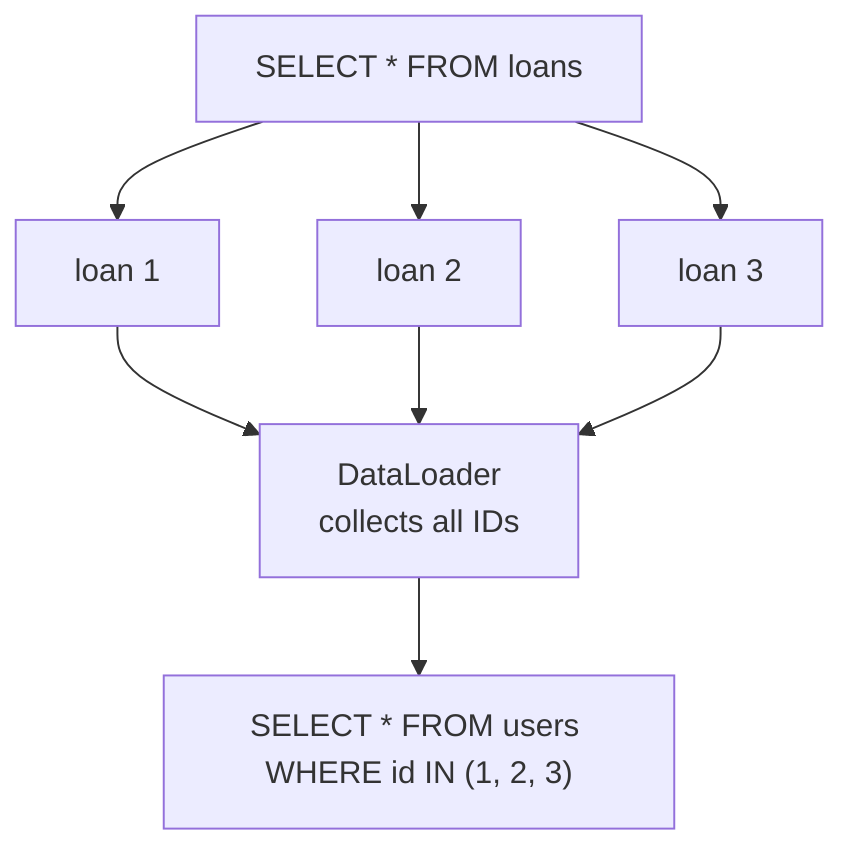
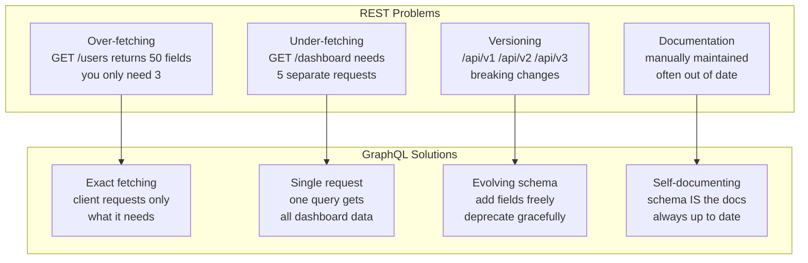
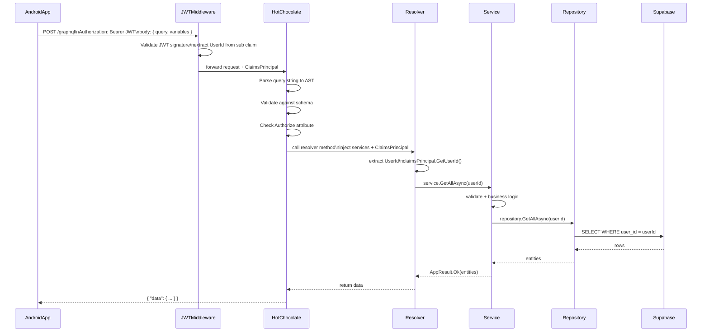

# Lesson 3 — GraphQL Engineering Deep Dive

## The Single Endpoint Question

This is the most common confusion when coming from REST.

In REST you have:
```
GET  /api/incomes
GET  /api/expenses
GET  /api/loans
POST /api/incomes
POST /api/loans/:id/repay
```

In GraphQL you have:
```
POST /graphql
POST /graphql
POST /graphql
POST /graphql
POST /graphql
```

**Same URL every time. So how does the server know what you want?**

The answer is in the **request body**.

---

## The Request Body IS the Intent

Every GraphQL request is a `POST` with a JSON body containing a `query` field.



The URL never changes. The **body** carries the intent.

This is exactly like how a database works:
- You always connect to the same database server
- But you send different SQL queries to get different data

GraphQL is essentially **a query language for your API** — just like SQL is a query language for your database.

---

## How Android / Kotlin Uses GraphQL

On Android with **Apollo GraphQL**, you write `.graphql` files:

```graphql
# GetIncomes.graphql
query GetIncomes {
  incomes {
    id
    amount
    source
    date
  }
}
```

Apollo generates Kotlin classes from these files at build time.
Then in your Android code:

```kotlin
// Apollo sends POST /graphql with the query in the body
val response = apolloClient.query(GetIncomesQuery()).execute()
val incomes = response.data?.incomes
```

Under the hood Apollo is doing exactly this HTTP call:

```http
POST https://your-api.com/graphql
Content-Type: application/json
Authorization: Bearer <JWT>

{
  "query": "query GetIncomes { incomes { id amount source date } }",
  "variables": {}
}
```

The server receives it, sees `incomes` in the query, calls the `Incomes` resolver, and returns:

```json
{
  "data": {
    "incomes": [
      { "id": "...", "amount": 5000, "source": "Salary", "date": "2025-01-01" }
    ]
  }
}
```

---

## The GraphQL Execution Engine — How It Works Internally



### Step 1 — Parse

The query string is parsed into an **Abstract Syntax Tree (AST)**:

```
query {           →   OperationDefinition (Query)
  incomes {       →     Field: incomes
    id            →       Field: id
    amount        →       Field: amount
  }               →
}
```

### Step 2 — Validate

The AST is checked against the schema:
- Does `incomes` exist on `Query`? ✅
- Does `Income` have an `id` field? ✅
- Does `Income` have an `amount` field? ✅
- Is the user authorized? ✅

If anything fails here, execution never happens — the error is returned immediately.

### Step 3 — Execute

Hot Chocolate walks the AST and calls the matching resolver for each field:



Each field has its own resolver. For simple properties like `id` and `amount`, Hot Chocolate resolves them automatically from the C# object. You only write resolvers for the root fields.

### Step 4 — Serialize

The resolved data is assembled into the JSON response shape that exactly mirrors the query structure.

---

## The Schema — The Contract Between Client and Server

The schema is the **single source of truth** for everything the API can do.



Both Android and Web clients generate their code **from the same schema**.
If you change the schema, both clients get updated types automatically.
This is called **schema-first development** and it eliminates an entire class of bugs where the frontend and backend disagree on data shapes.

---

## Variables — Parameterised Queries

Hard-coding values in queries is bad practice. GraphQL has **variables**:

```graphql
# Without variables — bad
mutation {
  addIncome(input: { amount: 5000, source: "Salary", description: "", date: "2025-01-01T00:00:00Z" }) {
    income { id }
  }
}

# With variables — correct
mutation AddIncome($input: AddIncomeInput!) {
  addIncome(input: $input) {
    income { id amount }
    errors
  }
}
```

The variables are sent separately in the request body:

```json
{
  "query": "mutation AddIncome($input: AddIncomeInput!) { ... }",
  "variables": {
    "input": {
      "amount": 5000,
      "source": "Salary",
      "description": "Monthly salary",
      "date": "2025-01-01T00:00:00Z"
    }
  }
}
```

Benefits:
- Variables are **type-checked** against the schema
- Queries can be **cached** by the client (same query string, different variables)
- Prevents injection attacks — variables are never interpolated into the query string

---

## Fragments — DRY Queries

If you query the same fields in multiple places, use a **fragment**:

```graphql
# Define once
fragment IncomeFields on Income {
  id
  amount
  source
  date
}

# Use everywhere
query {
  incomes {
    ...IncomeFields
  }
}

mutation {
  addIncome(input: $input) {
    income {
      ...IncomeFields
    }
  }
}
```

Apollo on Android/Kotlin generates a single Kotlin data class for `IncomeFields` and reuses it everywhere — DRY on the client side too.

---

## Aliases — Requesting the Same Field Twice

You can alias fields to rename them in the response or call the same field twice with different arguments:

```graphql
query {
  owedLoans: loans(type: Owed) {
    id
    counterpartyName
    remainingBalance
  }
  givenLoans: loans(type: Given) {
    id
    counterpartyName
    remainingBalance
  }
}
```

Response:
```json
{
  "data": {
    "owedLoans": [...],
    "givenLoans": [...]
  }
}
```

One request, two filtered lists. In REST you would need two separate HTTP calls.

---

## The N+1 Problem and DataLoader

This is one of the most important GraphQL engineering concepts.

Imagine you query loans and for each loan you want the counterparty details:

```graphql
query {
  loans {
    id
    counterparty {
      name
      email
    }
  }
}
```

Naively, for 10 loans this would execute:
- 1 query to get all loans
- 10 queries to get each counterparty

That is the **N+1 problem** — 1 + N database queries.



**DataLoader** solves this by batching:



GreenDonut (the DataLoader library in Hot Chocolate) handles this automatically. This is why `GreenDonut` is a dependency in our project.

---

## Introspection — Self-Documenting API

GraphQL APIs are **self-documenting**. You can query the schema itself:

```graphql
query {
  __schema {
    types {
      name
      fields {
        name
        type {
          name
        }
      }
    }
  }
}
```

This is how Banana Cake Pop (the GraphQL IDE) shows you all available queries, mutations, and types automatically — it just queries `__schema`.

This is also how Apollo on Android generates Kotlin code — it downloads the schema via introspection and generates type-safe classes.

```mermaid
flowchart LR
    BCP[Banana Cake Pop\nIDE]
    APOLLO[Apollo Codegen\nAndroid build]
    POSTMAN[Postman\nGraphQL mode]

    SCHEMA[/graphql\nintrospection]

    BCP --> SCHEMA
    APOLLO --> SCHEMA
    POSTMAN --> SCHEMA

    SCHEMA --> DOCS[Auto-generated docs\nand type-safe clients]
```

---

## Why GraphQL is Better Than REST



### Over-fetching

REST returns everything whether you need it or not:

```
GET /api/incomes
→ returns id, userId, amount, source, description, date, createdAt, updatedAt, ...
```

GraphQL returns only what you ask for:

```graphql
{ incomes { amount source } }
→ returns only amount and source
```

On mobile this matters enormously — less data = faster app = less battery.

### Under-fetching

The dashboard in REST requires multiple round trips:

```
GET /api/incomes    → wait
GET /api/expenses   → wait
GET /api/savings    → wait
GET /api/loans      → wait
```

In GraphQL it is one request:

```graphql
query {
  dashboard {
    totalIncome
    totalExpenses
    netBalance
    savingsProgress { name progress }
    loanSummary { totalOwed totalGiven }
  }
}
```

### No Versioning

In REST, breaking changes require a new version:
```
/api/v1/incomes  →  /api/v2/incomes
```

In GraphQL you **add** fields freely and **deprecate** old ones:

```graphql
type Income {
  id: ID!
  amount: Decimal!
  source: String!
  sourceCategory: String  # new field — old clients ignore it
  date: DateTime! @deprecated(reason: "Use createdAt instead")
}
```

Old clients keep working. New clients use new fields. No versions needed.

---

## GraphQL vs REST — When to Use Each

| Situation | Use |
|---|---|
| Mobile app with limited bandwidth | GraphQL — fetch only what you need |
| Multiple clients (Android, iOS, Web) with different data needs | GraphQL — one API, each client picks its fields |
| Public API consumed by unknown third parties | REST — simpler, more universal |
| Simple CRUD with no complex data relationships | REST — less overhead |
| Real-time features (chat, notifications) | GraphQL Subscriptions or REST + WebSockets |
| Dashboard aggregating many data sources | GraphQL — one query |
| File uploads | REST — GraphQL can do it but REST is simpler |

---

## The GraphQL Request Lifecycle in This Project



---

## Key Engineering Concepts Summary

| Concept | What it is | Why it matters |
|---|---|---|
| Single endpoint | `POST /graphql` always | Simpler routing, no URL versioning |
| Query body | Intent lives in the body not the URL | Client controls what data comes back |
| AST | Query parsed into a tree | Enables validation and execution |
| Schema | Auto-generated contract | Single source of truth for all clients |
| Resolver | Function that returns a field's data | Separation of concerns per field |
| Variables | Parameterised queries | Type-safe, cacheable, injection-safe |
| Fragments | Reusable field selections | DRY on the client side |
| Aliases | Rename or duplicate fields | Multiple filtered results in one request |
| Introspection | Query the schema itself | Self-documenting, enables code generation |
| DataLoader | Batch resolver calls | Solves N+1 database query problem |
| Deprecation | Mark fields as old | Evolve API without breaking clients |
| Payload pattern | Mutations return data or errors | No exceptions, predictable responses |

---

## How Apollo on Android Connects to This API

```kotlin
// 1. Create the Apollo client — points to your single endpoint
val apolloClient = ApolloClient.Builder()
    .serverUrl("https://your-api.com/graphql")
    .addHttpHeader("Authorization", "Bearer $jwtToken")
    .build()

// 2. Execute a query — Apollo sends POST /graphql with the query body
val incomesResponse = apolloClient
    .query(GetIncomesQuery())
    .execute()

// 3. Execute a mutation
val addResponse = apolloClient
    .mutation(AddIncomeMutation(
        input = AddIncomeInput(
            amount = 5000.0,
            source = "Salary",
            description = "Monthly",
            date = "2025-01-01T00:00:00Z"
        )
    ))
    .execute()

// 4. Check the payload
if (addResponse.data?.addIncome?.errors == null) {
    val income = addResponse.data?.addIncome?.income
    // success
} else {
    val errors = addResponse.data?.addIncome?.errors
    // handle errors
}
```

Apollo generates `GetIncomesQuery`, `AddIncomeMutation`, `AddIncomeInput` automatically from your `.graphql` files and the schema. You never write HTTP code manually.

---

## The Wonder of GraphQL

The real wonder of GraphQL is not just the technology — it is the **philosophy**:

> Give clients exactly what they ask for. Nothing more. Nothing less.

This single idea eliminates:
- Over-fetching (wasted bandwidth)
- Under-fetching (multiple round trips)
- API versioning (breaking changes)
- Documentation drift (schema is always current)
- Client-server disagreements (schema is the contract)

And it enables:
- Multiple clients with different needs from one API
- Type-safe code generation for every platform
- Self-documenting APIs
- Rapid frontend development without waiting for new endpoints
- Real-time data with subscriptions

For a finance app like this one — where Android, iOS, and Web all need the same data but in different shapes — GraphQL is the perfect fit.
