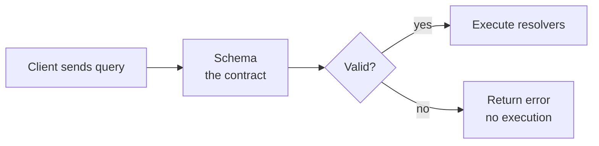
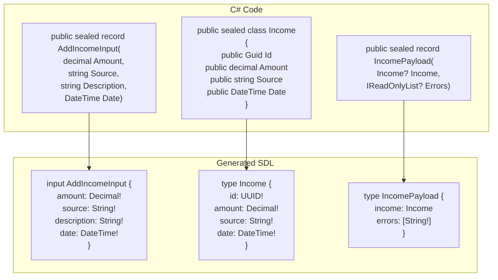
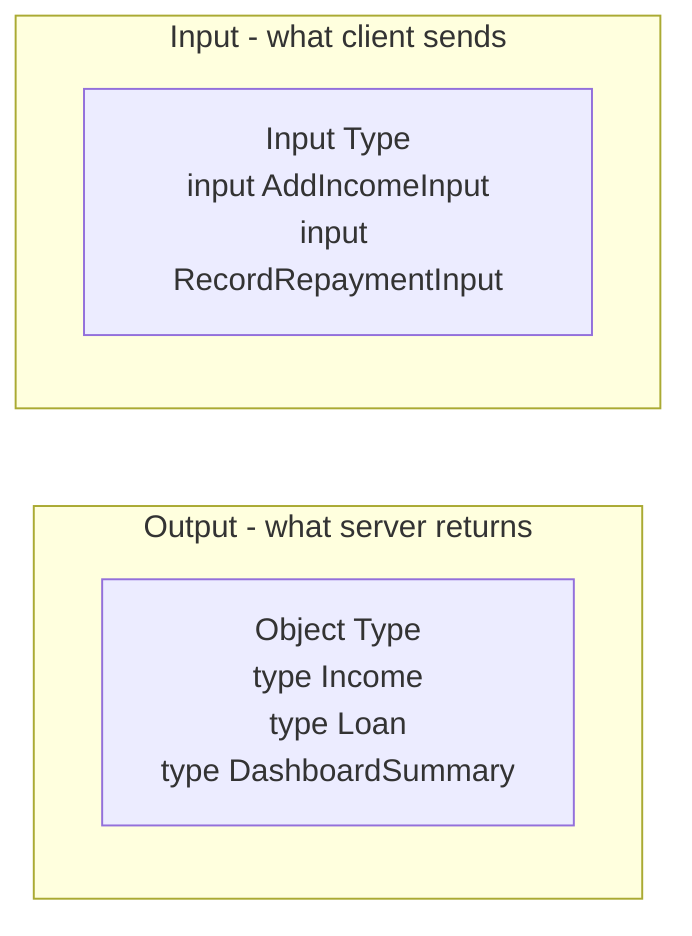
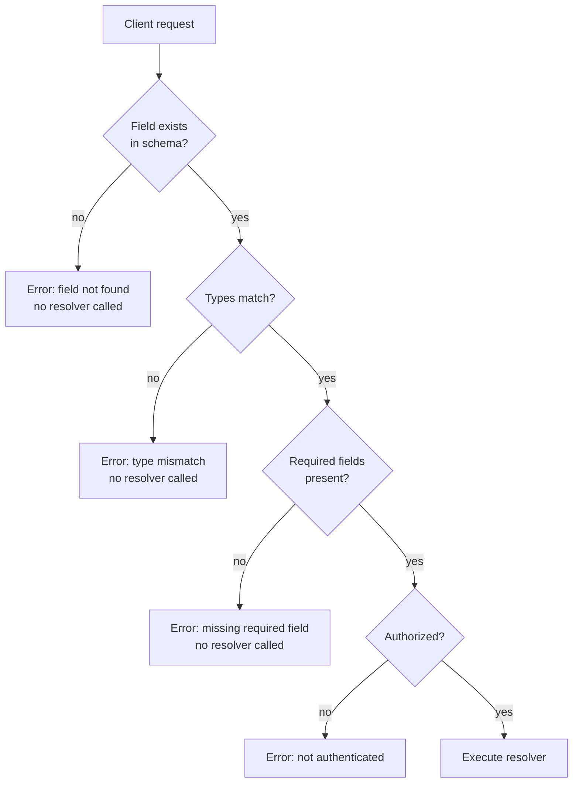
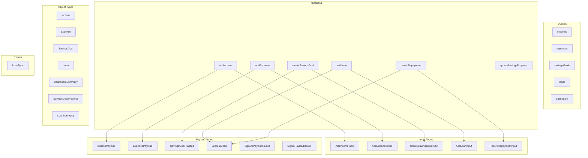

# Lesson 4 — The GraphQL Schema In Depth

## What the Schema Actually Is

The schema is not just documentation. It is the **executable contract** that the server enforces on every single request. If a client asks for a field that does not exist in the schema, the request is rejected before any resolver runs.



---

## SDL — Schema Definition Language

GraphQL schemas are described in SDL. You never write this manually in Hot Chocolate — it is generated from your C# code. But understanding it helps you reason about what the client sees.

```graphql
# Root types — entry points into the API
type Query {
  incomes: [Income!]!
  expenses: [Expense!]!
  savingsGoals: [SavingsGoal!]!
  loans: [Loan!]!
  dashboard: DashboardSummary!
}

type Mutation {
  addIncome(input: AddIncomeInput!): IncomePayload!
  addExpense(input: AddExpenseInput!): ExpensePayload!
  createSavingsGoal(input: CreateSavingsGoalInput!): SavingsGoalPayload!
  addLoan(input: AddLoanInput!): LoanPayload!
  recordRepayment(input: RecordRepaymentInput!): LoanPayload!
}

# Object types — your domain models
type Income {
  id: UUID!
  amount: Decimal!
  source: String!
  description: String!
  date: DateTime!
  createdAt: DateTime!
}

# Input types — used only in mutations
input AddIncomeInput {
  amount: Decimal!
  source: String!
  description: String!
  date: DateTime!
}

# Payload types — mutation responses
type IncomePayload {
  income: Income          # null on failure
  errors: [String!]       # null on success
}

# Enum types
enum LoanType {
  OWED
  GIVEN
}
```

---

## How C# Maps to GraphQL Schema

Hot Chocolate reads your C# and generates the SDL automatically.



### The mapping rules

| C# type | GraphQL type |
|---|---|
| `string` | `String` (nullable) |
| `string` (non-null context) | `String!` |
| `int`, `decimal` | `Int!`, `Decimal!` |
| `Guid` | `UUID!` |
| `DateTime` | `DateTime!` |
| `bool` | `Boolean!` |
| `T?` | `T` (nullable) |
| `List<T>` | `[T!]!` |
| `IReadOnlyList<T>?` | `[T!]` (nullable list) |
| `enum` | `enum` |
| `record` / `class` (input) | `input` type |
| `record` / `class` (output) | `type` |

---

## Non-Null vs Nullable — Why It Matters

The `!` in GraphQL means the field is **guaranteed to never be null**.

```graphql
type Income {
  id: UUID!          # always present — safe to use directly
  amount: Decimal!   # always present
  description: String!  # always present (even if empty string)
  dueDate: DateTime  # nullable — may be null, client must check
}
```

On Android with Apollo, this translates directly to Kotlin nullability:

```kotlin
// id is UUID! in schema → non-null in Kotlin
val id: String = income.id          // no null check needed

// dueDate is DateTime in schema → nullable in Kotlin
val due: String? = loan.dueDate     // must handle null
if (due != null) { ... }
```

This is one of GraphQL's most powerful features — **nullability is part of the contract**. The client knows at compile time which fields can be null.

---

## Object Types vs Input Types

GraphQL has two kinds of complex types:



**Object types** can have resolvers, computed fields, and relationships.
**Input types** are plain data containers — no resolvers, no computed fields.

You cannot use an object type as a mutation argument. You must use an input type. This is why we have separate `AddIncomeInput` and `Income` — they serve different purposes.

---

## Scalar Types — The Primitives

GraphQL has 5 built-in scalars:

| Scalar | Description |
|---|---|
| `String` | UTF-8 text |
| `Int` | 32-bit integer |
| `Float` | Double-precision float |
| `Boolean` | true or false |
| `ID` | Unique identifier — serialised as string |

Hot Chocolate adds custom scalars for .NET:

| Custom Scalar | C# type |
|---|---|
| `Decimal` | `decimal` |
| `DateTime` | `DateTime` |
| `UUID` | `Guid` |
| `Long` | `long` |
| `Byte` | `byte` |
| `Short` | `short` |

---

## Enums in GraphQL

Our `LoanType` enum in C#:

```csharp
public enum LoanType
{
    Owed,
    Given
}
```

Becomes in GraphQL:

```graphql
enum LoanType {
  OWED
  GIVEN
}
```

In a query:

```graphql
mutation {
  addLoan(input: {
    counterpartyName: "John"
    amount: 2000
    type: OWED        # enum value — no quotes
    description: ""
    date: "2025-01-01T00:00:00Z"
  }) {
    loan { id type remainingBalance }
    errors
  }
}
```

---

## The `@deprecated` Directive

When you need to rename or remove a field, you never delete it immediately — you deprecate it first. Old clients keep working, new clients use the new field.

```graphql
type Income {
  id: UUID!
  amount: Decimal!
  source: String!
  incomeSource: String! @deprecated(reason: "Use source instead")
}
```

In Hot Chocolate:

```csharp
[GraphQLDeprecated("Use Source instead")]
public string IncomeSource => Source;
```

---

## Introspection — Querying the Schema Itself

Every GraphQL server exposes its own schema through introspection queries. This is how Banana Cake Pop, Postman, and Apollo all know what fields are available.

```graphql
# Ask the server what types exist
query {
  __schema {
    types {
      name
      kind
    }
  }
}

# Ask about a specific type
query {
  __type(name: "Income") {
    fields {
      name
      type {
        name
        kind
      }
    }
  }
}
```

Response:
```json
{
  "data": {
    "__type": {
      "fields": [
        { "name": "id",          "type": { "name": "UUID",     "kind": "SCALAR" } },
        { "name": "amount",      "type": { "name": "Decimal",  "kind": "SCALAR" } },
        { "name": "source",      "type": { "name": "String",   "kind": "SCALAR" } },
        { "name": "date",        "type": { "name": "DateTime", "kind": "SCALAR" } }
      ]
    }
  }
}
```

---

## How the Schema Protects Your API

The schema acts as a **first line of defence** before any of your code runs:



By the time your resolver runs, you are guaranteed:
- All required fields are present
- All types are correct
- The user is authenticated (if `[Authorize]` is set)

---

## Schema in This Project — Full Picture



---

## Key Takeaways

| Concept | What it means |
|---|---|
| Schema | Executable contract — enforced on every request |
| SDL | Human-readable schema language — auto-generated from C# |
| Object type | Output data shape — what the server returns |
| Input type | Input data shape — what the client sends |
| Scalar | Primitive value — String, Int, Decimal, UUID, DateTime |
| Non-null `!` | Guaranteed never null — safe to use without null checks |
| Enum | Fixed set of values — type-safe on both client and server |
| `@deprecated` | Mark old fields — evolve without breaking clients |
| Introspection | Query the schema itself — powers IDEs and code generation |
