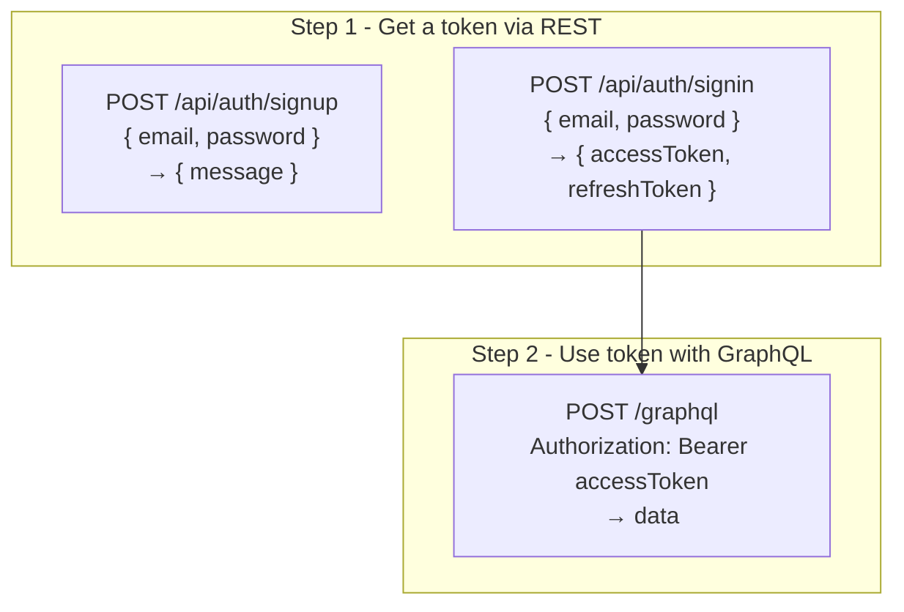
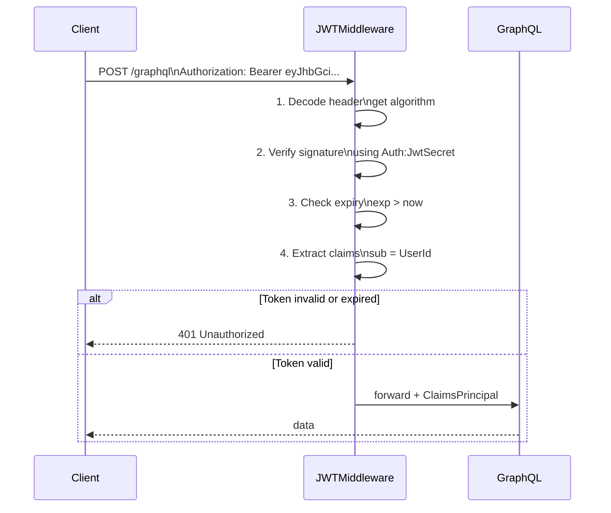
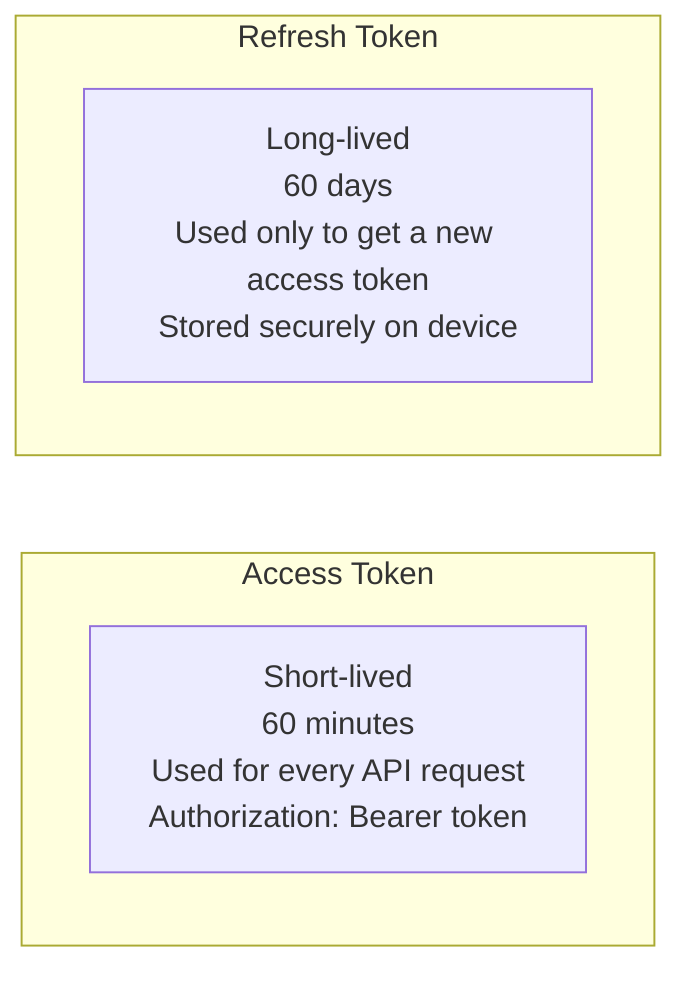
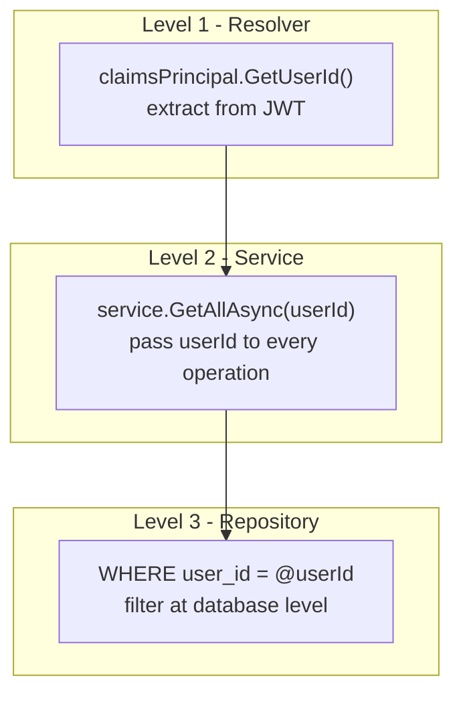
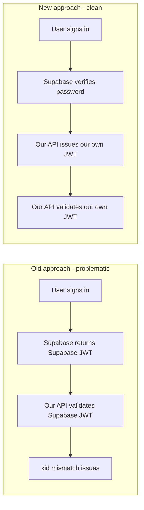
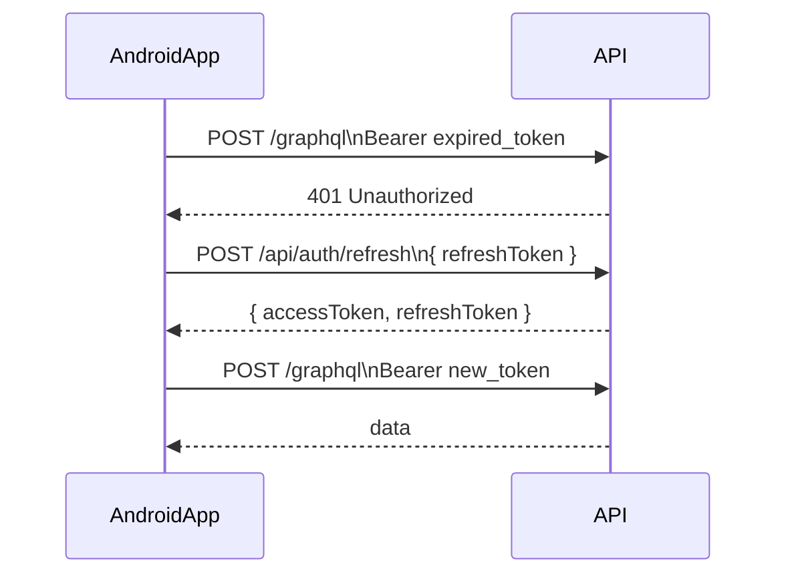

# Lesson 6 — Authentication and Security in GraphQL

## How Auth Works in This Project

We use a hybrid approach — REST for auth, GraphQL for everything else.



---

## JWT — JSON Web Token

A JWT is a self-contained token that carries claims about the user. It has three parts separated by dots:

```
eyJhbGciOiJIUzI1NiIsInR5cCI6IkpXVCJ9    ← Header (Base64)
.eyJzdWIiOiIxMjM0NTY3ODkwIiwibmFtZSI6Ikpv  ← Payload (Base64)
.SflKxwRJSMeKKF2QT4fwpMeJf36POk6yJV_adQssw  ← Signature (HMAC)
```

### Header
```json
{
  "alg": "HS256",
  "typ": "JWT"
}
```

### Payload (claims)
```json
{
  "sub": "3fa85f64-5717-4562-b3fc-2c963f66afa6",
  "email": "user@example.com",
  "iat": 1704067200,
  "exp": 1704070800
}
```

- `sub` — subject — the user's ID — this is what we extract as `UserId`
- `iat` — issued at — Unix timestamp
- `exp` — expiry — Unix timestamp
- `email` — custom claim we add

### Signature
The signature is created by hashing the header + payload with our secret key. If anyone tampers with the token, the signature won't match and validation fails.

---

## JWT Validation Flow



---

## Access Token vs Refresh Token



### Why two tokens?

If the access token is stolen, it expires in 60 minutes — limited damage.
If you only had one long-lived token and it was stolen, the attacker has access for 60 days.

### The refresh flow on Android

```kotlin
// Access token expired — get a new one silently
suspend fun refreshTokens(refreshToken: String): SignInPayload {
    val response = httpClient.post("$baseUrl/api/auth/refresh") {
        setBody(mapOf("refreshToken" to refreshToken))
    }
    return response.body()
}

// Apollo interceptor — runs before every request
class AuthInterceptor : HttpInterceptor {
    override suspend fun intercept(request: HttpRequest, chain: HttpInterceptorChain): HttpResponse {
        val token = tokenStore.getAccessToken()

        if (tokenStore.isExpired(token)) {
            val newTokens = refreshTokens(tokenStore.getRefreshToken())
            tokenStore.save(newTokens)
        }

        return chain.proceed(request.newBuilder()
            .addHeader("Authorization", "Bearer ${tokenStore.getAccessToken()}")
            .build())
    }
}
```

---

## UserId Scoping — Data Isolation

Every piece of data in this project is scoped to the authenticated user. This is enforced at three levels:



Even if someone passes a valid JWT for User A, they can only ever see User A's data. The `userId` extracted from the token is used in every database query.

```csharp
// Repository — userId is always in the WHERE clause
public Task<List<Income>> GetAllAsync(Guid userId, CancellationToken ct) =>
    db.Incomes
      .Where(x => x.UserId == userId)   // ← enforced here
      .OrderByDescending(x => x.Date)
      .ToListAsync(ct);
```

---

## The `[Authorize]` Attribute in Hot Chocolate

```csharp
public sealed class Query
{
    // Public — no token needed
    // GET /health is also public but lives in REST
    public string Health() => "Finance Tracker API is running!";

    // Protected — valid JWT required
    [Authorize]
    public async Task<List<Income>> Incomes(
        [Service] IIncomeService service,
        ClaimsPrincipal claimsPrincipal,
        CancellationToken ct)
    {
        var userId = claimsPrincipal.GetUserId();
        var result = await service.GetAllAsync(userId, ct);
        return result.Value!;
    }
}
```

When `[Authorize]` is present and no valid JWT is provided:

```json
{
  "errors": [
    {
      "message": "The current user is not authorized to access this resource.",
      "extensions": { "code": "AUTH_NOT_AUTHENTICATED" }
    }
  ],
  "data": null
}
```

---

## Our Custom JWT — Why We Moved Away From Supabase JWT

Originally we tried to validate Supabase's JWT tokens directly. We hit two problems:

1. Supabase tokens include a `kid` (Key ID) header that the validator uses for key lookup
2. The JWT secret encoding (Base64 vs UTF-8) was ambiguous

**The solution** — we generate our own JWT tokens. Supabase is used only to verify the email/password. Once verified, we issue our own token signed with `Auth:JwtSecret`.



Benefits:
- Full control over token format and claims
- No dependency on Supabase JWT format
- Works identically locally and on Azure
- Easy to add custom claims (roles, permissions) later

---

## Security Best Practices Applied

| Practice | How we apply it |
|---|---|
| Short-lived access tokens | 60 minutes — configurable via `Auth:AccessTokenMinutes` |
| Refresh tokens | Long-lived, stored securely on device |
| JWT signature validation | Every request validated with `Auth:JwtSecret` |
| UserId from token only | Never trust UserId from request body |
| Data scoping | Every DB query filters by `UserId` |
| Secrets in config | Never hardcoded — `appsettings.Development.json` is gitignored |
| HTTPS in production | Azure provides free SSL — all traffic encrypted |
| Password hashing | Supabase handles this — bcrypt internally |

---

## What Happens When the Token Expires



The Android app should handle `401` responses by automatically refreshing the token. Apollo's `AuthInterceptor` does this transparently — the user never sees a login screen.

---

## Key Takeaways

| Concept | What it means |
|---|---|
| JWT | Self-contained token with user claims — no DB lookup needed |
| `sub` claim | The user's ID — extracted as `UserId` in every resolver |
| Access token | Short-lived — used for every API request |
| Refresh token | Long-lived — used to get new access tokens silently |
| `[Authorize]` | Rejects requests without a valid JWT |
| `GetUserId()` | Extracts `sub` claim from `ClaimsPrincipal` |
| Data scoping | Every query filters by `UserId` — cross-user access impossible |
| Our own JWT | We issue tokens — Supabase only verifies passwords |
| `Auth:JwtSecret` | Our signing key — never committed to git |
