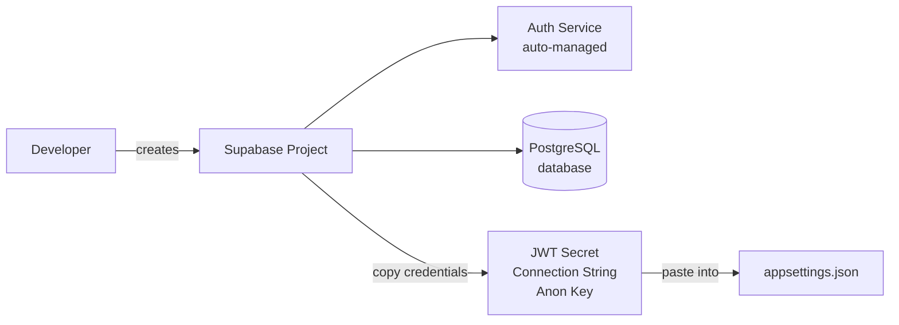
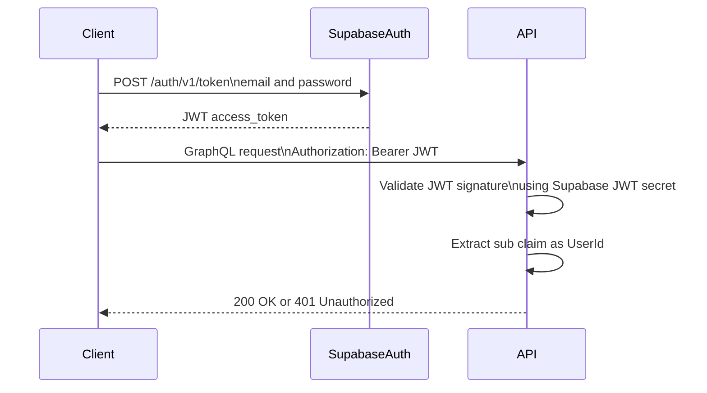
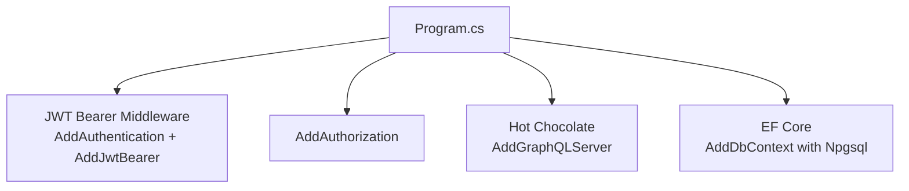

# Phase 0 — Foundation and Project Setup

## Goal
Establish the project skeleton, wire up Supabase (PostgreSQL + Auth), configure EF Core, and set up JWT middleware — so every future phase builds on a solid, working base.

---

## Checklist

- [x] Clean Architecture folder structure in place
- [x] `Result<T>` and `Result` pattern in `Domain/Common`
- [x] `Query.cs` and `Mutation.cs` scaffolded
- [x] `appsettings.json` with Supabase credential placeholders
- [x] SQL migration scripts in `scripts/db/`
- [ ] NuGet packages installed
- [ ] EF Core + Npgsql connected to Supabase PostgreSQL
- [ ] JWT Bearer middleware configured with Supabase JWT secret
- [ ] App boots and `/graphql` endpoint is reachable
- [ ] `health` query returns a response
- [ ] Protected query returns `401` without a valid JWT

---

## Folder Structure

```
FinanceTracker/
├── Domain/
│   ├── Common/
│   │   └── Result.cs               done
│   ├── Entities/                   Phase 1
│   └── Enums/                      Phase 1
├── Application/
│   ├── Interfaces/                 Phase 2 and 3
│   ├── Services/                   Phase 3
│   └── DTOs/                       Phase 3
├── Infrastructure/
│   ├── Data/
│   │   └── AppDbContext.cs         Phase 2
│   └── Repositories/               Phase 2
├── Api/
│   ├── GraphQL/
│   │   ├── Query.cs                done
│   │   └── Mutation.cs             done
├── scripts/
│   ├── db/                         SQL migrations done
│   ├── apply-migrations.sh         done
│   ├── validate-migrations.sh      done
│   └── rollback-migrations.sh      done
├── appsettings.json                done
└── Program.cs                      done
```

---

## Supabase Setup Flow



---

## JWT Authentication Flow



---

## Program.cs Wiring



---

## NuGet Packages

| Package | Purpose |
|---|---|
| `HotChocolate.AspNetCore` | GraphQL server — already installed |
| `HotChocolate.Authorization` | Authorize attribute support |
| `Microsoft.AspNetCore.Authentication.JwtBearer` | JWT validation |
| `Microsoft.EntityFrameworkCore` | ORM |
| `Npgsql.EntityFrameworkCore.PostgreSQL` | Supabase / PostgreSQL driver |
| `Microsoft.EntityFrameworkCore.Design` | EF CLI tooling |

---

## appsettings.json Shape

```json
{
  "Supabase": {
    "Url": "https://<project-ref>.supabase.co",
    "AnonKey": "<supabase-anon-key>",
    "JwtSecret": "<supabase-jwt-secret>"
  },
  "ConnectionStrings": {
    "Default": "Host=db.<project-ref>.supabase.co;Port=5432;Database=postgres;Username=postgres.<project-ref>;Password=<db-password>;SSL Mode=Require;Trust Server Certificate=true"
  }
}
```

---

## Exit Criteria

- `dotnet run` starts with no errors
- `/graphql` returns the Banana Cake Pop UI
- `{ health }` query returns `"Finance Tracker API is running!"`
- A protected query without a JWT returns `401`
- `validate-migrations.sh` passes against the Supabase database
