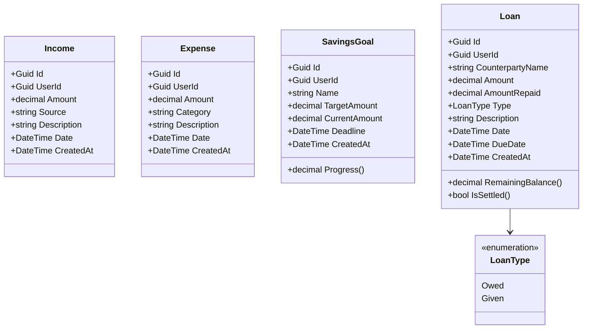
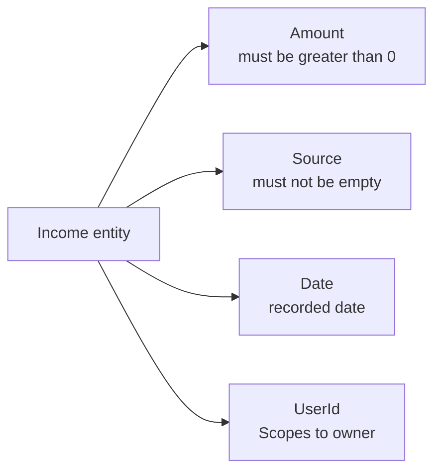
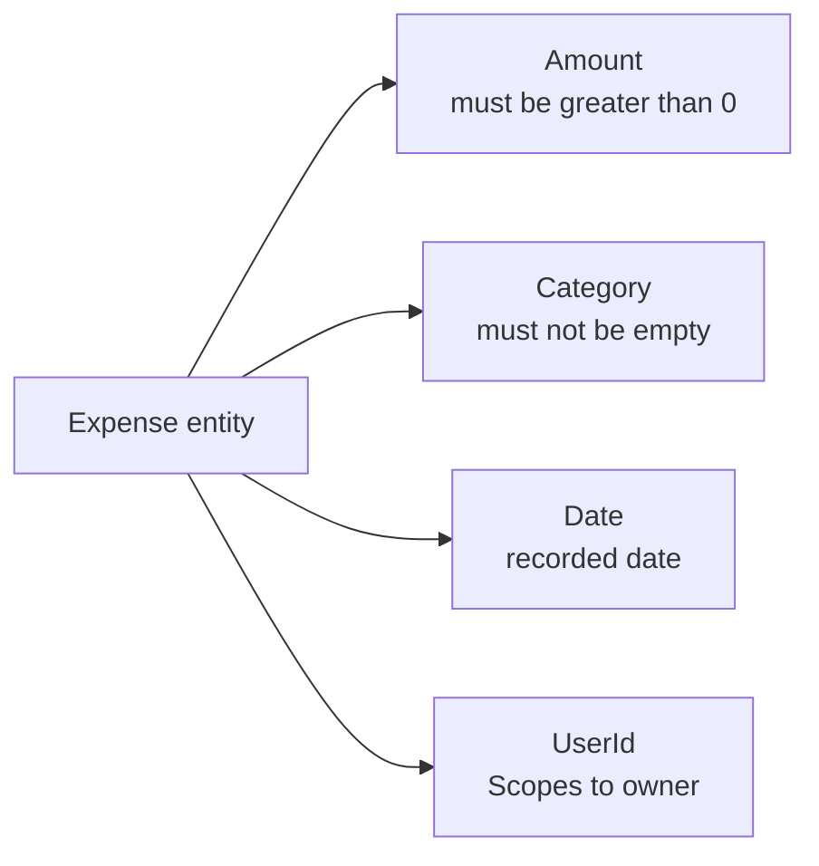
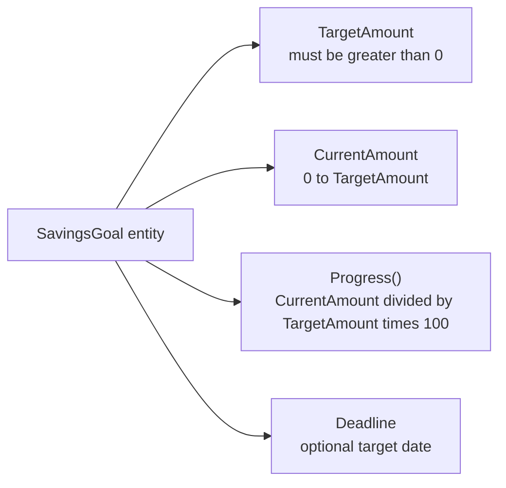
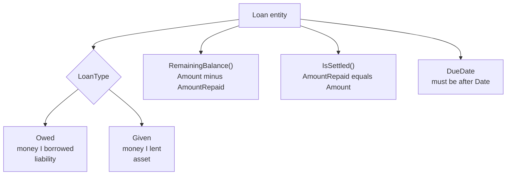
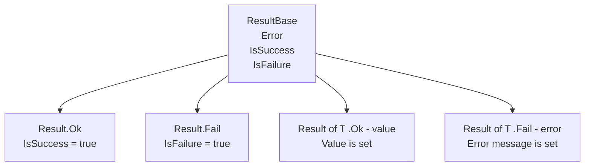

# Phase 1 — Domain Layer

## Goal
Define all core business entities and enums. This layer is the heart of the application — pure C#, zero external dependencies.

---

## Checklist

- [ ] `LoanType` enum created
- [ ] `Income` entity created
- [ ] `Expense` entity created
- [ ] `SavingsGoal` entity with `Progress()` computed method
- [ ] `Loan` entity with `RemainingBalance()` computed method
- [ ] All entities carry `UserId` (Supabase Auth UUID)
- [ ] All entities enforce invariants via constructor — no public setters on required fields

---

## Folder Structure

```
Domain/
├── Common/
│   └── Result.cs           done
├── Entities/
│   ├── Income.cs
│   ├── Expense.cs
│   ├── SavingsGoal.cs
│   └── Loan.cs
└── Enums/
    └── LoanType.cs
```

---

## Entities



---

## Feature — Income



---

## Feature — Expenses



---

## Feature — Savings Goals



---

## Feature — Loans



---

## Result Pattern



> `ResultBase` holds all shared properties. `Result` and `Result<T>` extend it — no duplicated code.

---

## SOLID and Design Rules

| Rule | How it applies |
|---|---|
| Single Responsibility | Each entity owns only its own data and computed properties |
| Open / Closed | New features add new entities — existing ones are not modified |
| Dependency Inversion | Domain has no dependencies — all other layers depend on it |
| DRY | `Result<T>` and `Result` share no duplicated logic |
| No EF Core | Zero ORM attributes or references in this layer |
| No public setters | Required fields set via constructor only |

---

## Exit Criteria

- All entities compile with no external references
- `Progress()` returns the correct percentage value
- `RemainingBalance()` returns the correct remaining amount
- `IsSettled()` returns true when fully repaid
- `Result.Ok` and `Result.Fail` behave correctly
