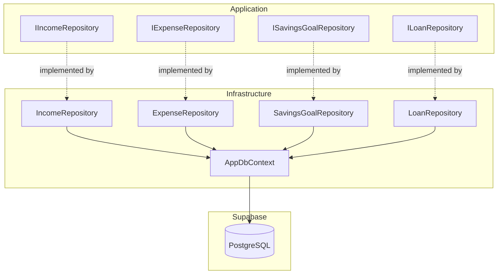
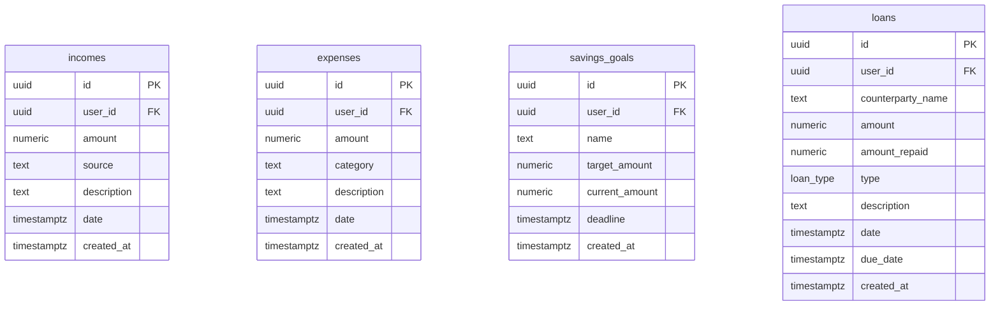
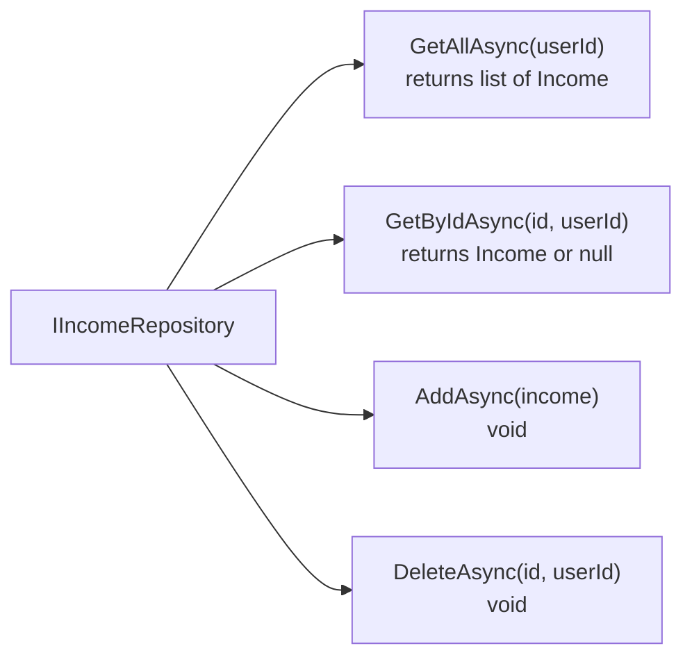
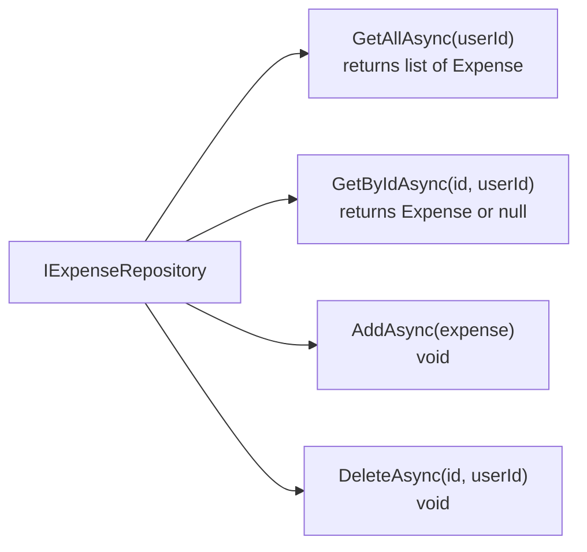
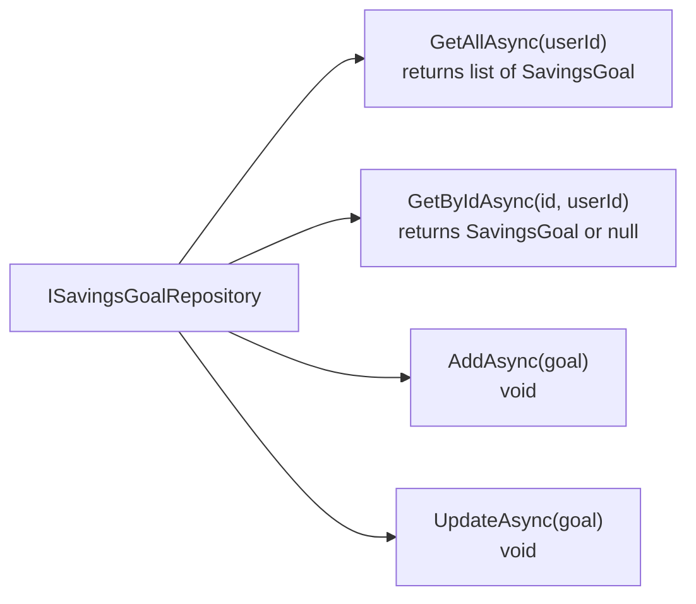
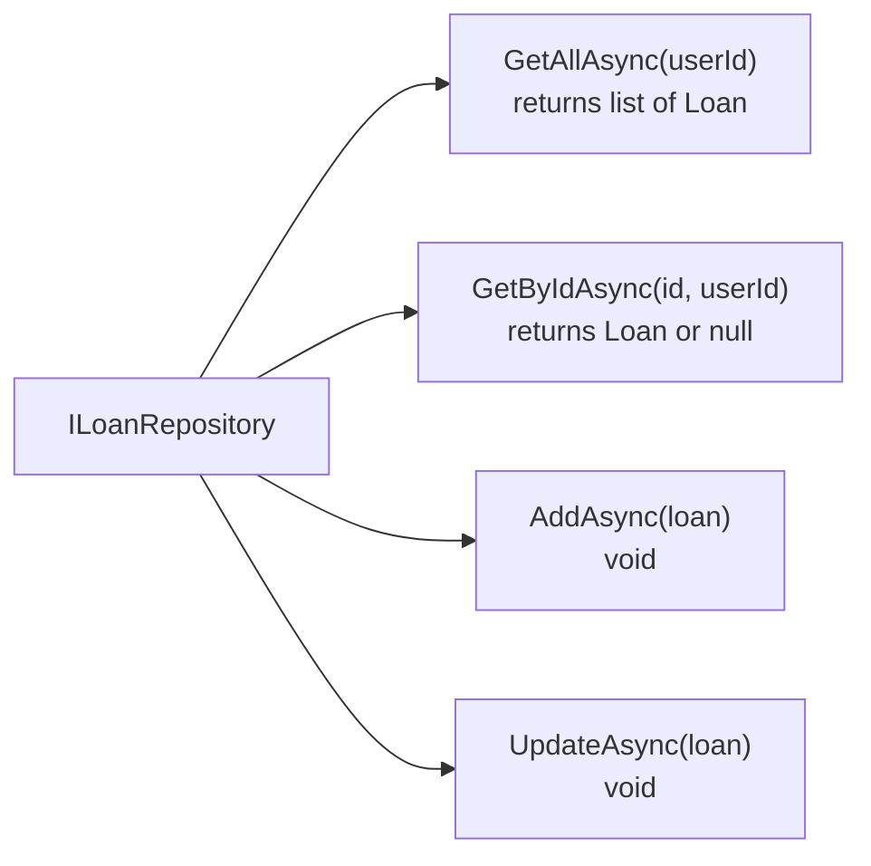
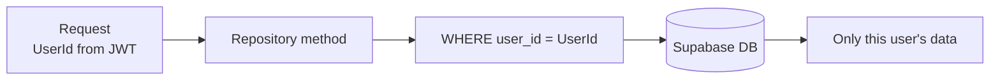
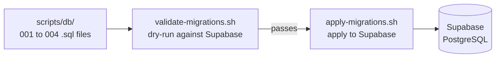

# Phase 2 — Infrastructure Layer

## Goal
Connect to Supabase PostgreSQL via EF Core, apply the SQL migrations, and implement all repositories. Repositories are the only place that touches the database.

---

## Checklist

- [ ] `AppDbContext` configured with all entity `DbSet`s and table mappings
- [ ] EF Core column mappings match the SQL migration schema
- [ ] SQL migrations applied to Supabase via `apply-migrations.sh`
- [ ] `IIncomeRepository` interface defined in Application layer
- [ ] `IExpenseRepository` interface defined in Application layer
- [ ] `ISavingsGoalRepository` interface defined in Application layer
- [ ] `ILoanRepository` interface defined in Application layer
- [ ] All four repository implementations complete
- [ ] All repositories registered in DI in `Program.cs`

---

## Folder Structure

```
Application/
└── Interfaces/
    ├── IIncomeRepository.cs
    ├── IExpenseRepository.cs
    ├── ISavingsGoalRepository.cs
    └── ILoanRepository.cs

Infrastructure/
├── Data/
│   └── AppDbContext.cs
└── Repositories/
    ├── IncomeRepository.cs
    ├── ExpenseRepository.cs
    ├── SavingsGoalRepository.cs
    └── LoanRepository.cs

scripts/
└── db/
    ├── 000_create_profiles.sql         done
    ├── 001_create_incomes.sql          done
    ├── 002_create_expenses.sql         done
    ├── 003_create_savings_goals.sql    done
    ├── 004_create_loans.sql            done
    └── rollback/
        ├── rollback_profiles.sql       done
        ├── rollback_loans.sql          done
        ├── rollback_savings_goals.sql  done
        ├── rollback_expenses.sql       done
        └── rollback_incomes.sql        done
```

---

## Architecture



---

## Database Schema



---

## Feature — Income Repository



---

## Feature — Expense Repository



---

## Feature — Savings Goal Repository



---

## Feature — Loan Repository



---

## UserId Scoping Rule



> Every query and command filters by `UserId`. Cross-user data access is impossible at the repository level.

---

## Migration Workflow



---

## SOLID and Design Rules

| Rule | How it applies |
|---|---|
| Single Responsibility | Each repository handles one entity only |
| Interface Segregation | One interface per repository — no fat interfaces |
| Dependency Inversion | Application defines interfaces, Infrastructure implements them |
| DRY | Common query patterns shared via base repository if needed |
| Open / Closed | New features add new repositories — existing ones unchanged |

---

## Exit Criteria

- SQL migrations apply cleanly via `apply-migrations.sh`
- `validate-migrations.sh` passes with no errors
- All four tables exist in Supabase with correct columns and constraints
- Repositories return only records belonging to the requesting user
- DI resolves all repository interfaces to their implementations
