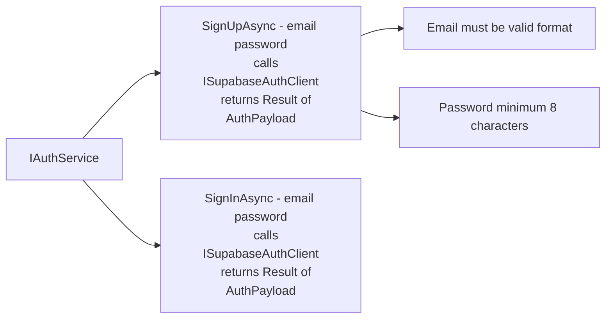
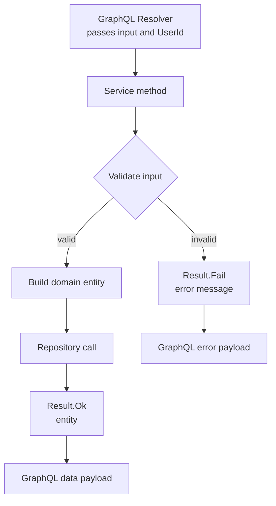
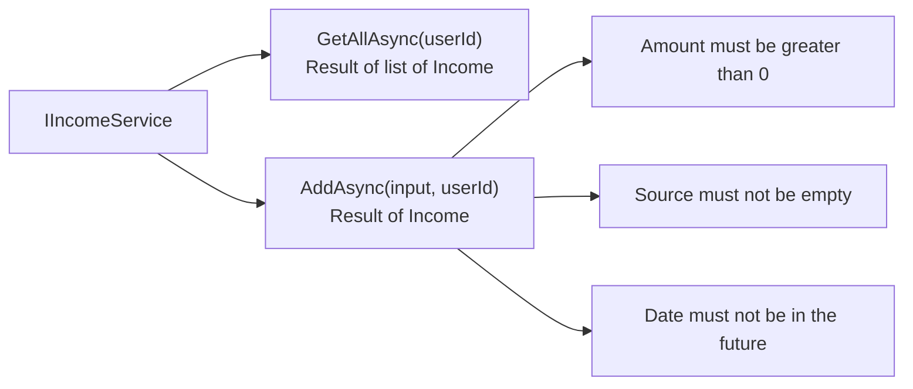
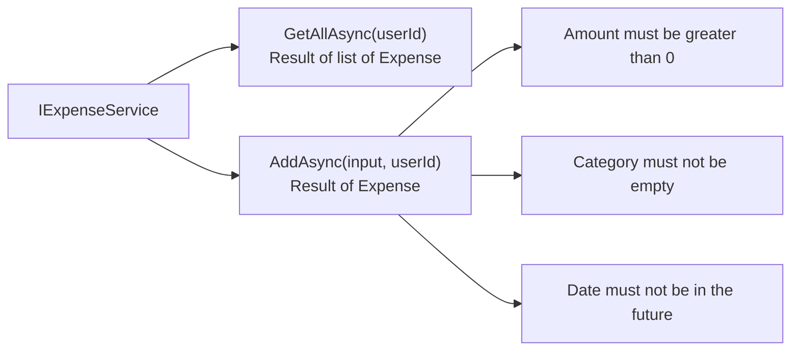
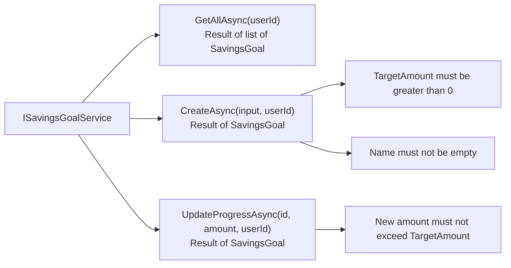
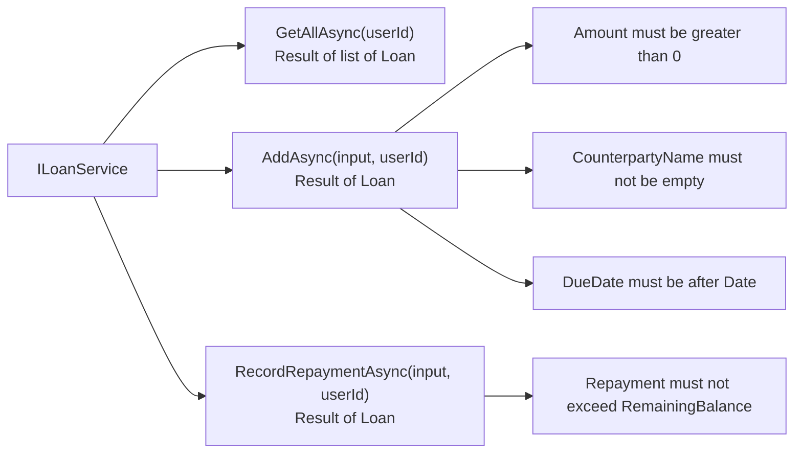
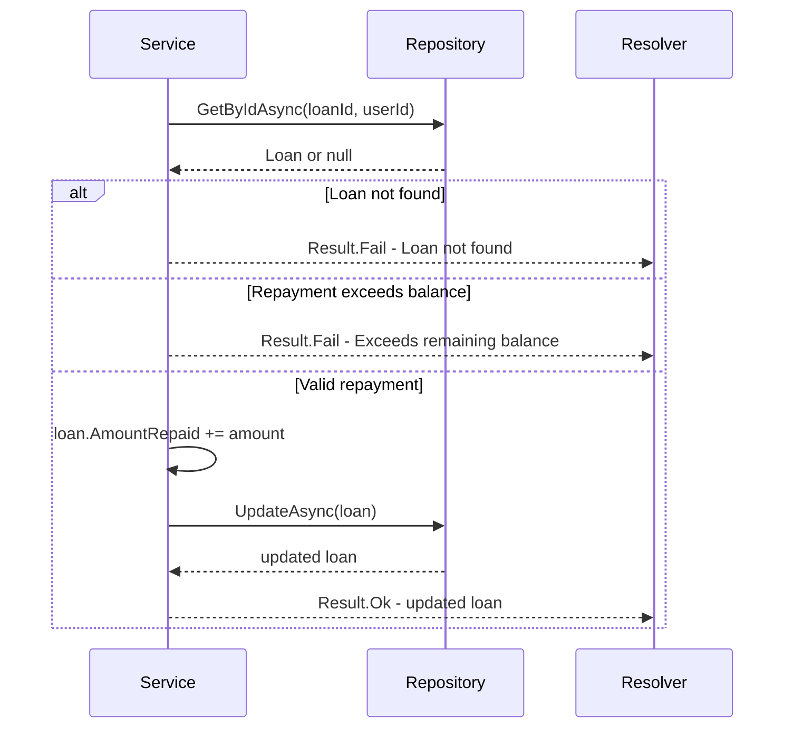

# Phase 3 — Application Layer

## Goal
Implement all business logic through services. Services orchestrate domain entities, call repositories, validate inputs, and return `Result<T>`. No GraphQL, no EF Core, no HTTP concerns here.

---

## Checklist

- [x] DTOs defined for all inputs
- [x] `IAuthService` interface and `AuthService` implementation
- [x] `IIncomeService` interface and `IncomeService` implementation
- [x] `IExpenseService` interface and `ExpenseService` implementation
- [x] `ISavingsGoalService` interface and `SavingsGoalService` implementation
- [x] `ILoanService` interface and `LoanService` implemented
- [x] All services return `AppResult<T>` or `AppResult`
- [x] All validation rules enforced in services
- [x] All services registered in DI

---

## Folder Structure

```
Application/
├── Interfaces/
│   ├── IAuthService.cs
│   ├── IIncomeRepository.cs        Phase 2
│   ├── IExpenseRepository.cs       Phase 2
│   ├── ISavingsGoalRepository.cs   Phase 2
│   ├── ILoanRepository.cs          Phase 2
│   ├── IIncomeService.cs
│   ├── IExpenseService.cs
│   ├── ISavingsGoalService.cs
│   └── ILoanService.cs
├── Services/
│   ├── AuthService.cs
│   ├── IncomeService.cs
│   ├── ExpenseService.cs
│   ├── SavingsGoalService.cs
│   └── LoanService.cs
└── DTOs/
    ├── Auth/
    │   ├── SignUpInput.cs
    │   ├── SignInInput.cs
    │   └── AuthPayload.cs
    ├── Income/
    │   └── AddIncomeInput.cs
    ├── Expense/
    │   └── AddExpenseInput.cs
    ├── Savings/
    │   └── CreateSavingsGoalInput.cs
    └── Loan/
        ├── AddLoanInput.cs
        └── RecordRepaymentInput.cs
```

---

## Feature — Auth Service



> `AuthService` depends on `ISupabaseAuthClient` — an interface wrapping the Supabase HTTP calls. This keeps `AuthService` testable and decoupled from the HTTP client (Dependency Inversion).

---

## Service Flow — All Features



---

## Feature — Income Service



---

## Feature — Expense Service



---

## Feature — Savings Goal Service



---

## Feature — Loan Service



---

## Feature — Loan Repayment Flow



---

## Validation Rules

| Field | Rule |
|---|---|
| `Amount` | Must be greater than 0 |
| `Date` | Must not be in the future for income and expenses |
| `Source` | Must not be empty |
| `Category` | Must not be empty |
| `Name` | Must not be empty |
| `TargetAmount` | Must be greater than 0 |
| `CurrentAmount` | Must be between 0 and TargetAmount |
| `DueDate` | Must be after `Date` |
| `RepaymentAmount` | Must not exceed `RemainingBalance` |
| `CounterpartyName` | Must not be empty |

---

## SOLID and Design Rules

| Rule | How it applies |
|---|---|
| Single Responsibility | Each service handles one feature domain only |
| Open / Closed | New features add new services — existing ones are not modified |
| Liskov Substitution | Service interfaces can be swapped for test doubles |
| Interface Segregation | One interface per service — no fat interfaces |
| Dependency Inversion | Services depend on repository interfaces, not implementations |
| DRY | Shared validation helpers extracted if used across services |

---

## Exit Criteria

- All services compile and resolve via DI
- Valid inputs produce `Result.Ok` with the entity
- Invalid inputs produce `Result.Fail` with a clear message
- Repayment exceeding balance returns `Result.Fail`
- No EF Core, GraphQL, or HTTP references anywhere in this layer
