# Phase 4 — GraphQL API Layer

## Goal
Expose all features through a clean, authenticated GraphQL API. Resolvers are thin — extract `UserId` from the JWT, call the service, return the result. No business logic lives here.

---

## Checklist

- [ ] JWT Bearer + Hot Chocolate authorization wired in `Program.cs`
- [ ] `signUp` mutation calls Supabase Auth and returns JWT
- [ ] `signIn` mutation calls Supabase Auth and returns JWT
- [ ] All queries protected with `[Authorize]`
- [ ] All mutations except `signUp` and `signIn` protected with `[Authorize]`
- [ ] `UserId` extracted from `ClaimsPrincipal` in every protected resolver
- [ ] `health` query remains public
- [ ] All mutations return typed payloads with data or error
- [ ] Dashboard query returns aggregated summary

---

## Folder Structure

```
Api/
└── GraphQL/
    ├── Query.cs
    └── Mutation.cs

Application/
├── Interfaces/
│   └── IAuthService.cs
├── Services/
│   └── AuthService.cs
└── DTOs/
    └── Auth/
        ├── SignUpInput.cs
        ├── SignInInput.cs
        └── AuthPayload.cs
```

---

## Full API Map

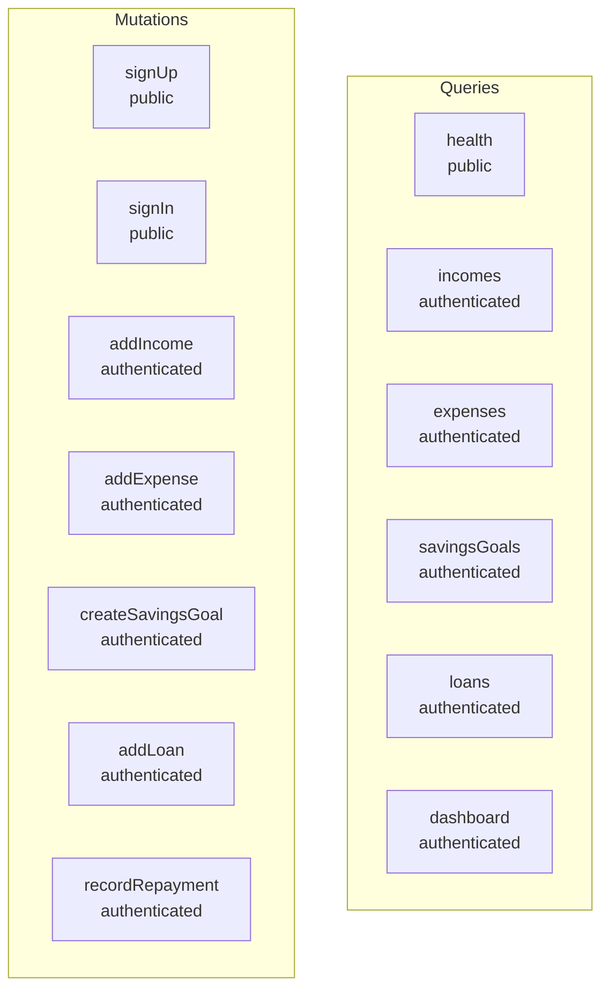

---

## Resolver Pattern

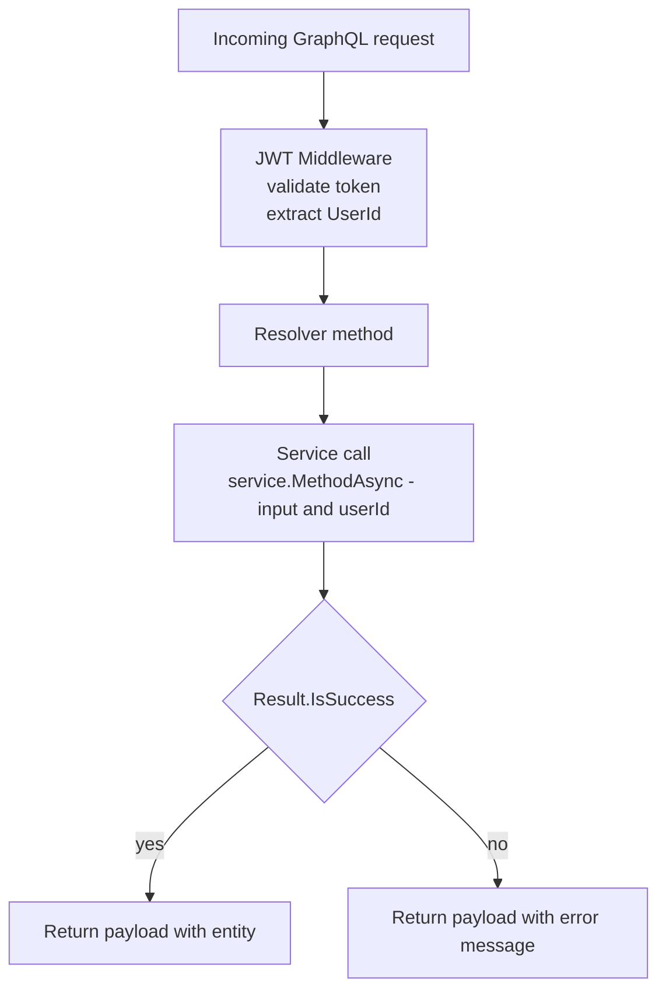

---

## Feature — Authentication

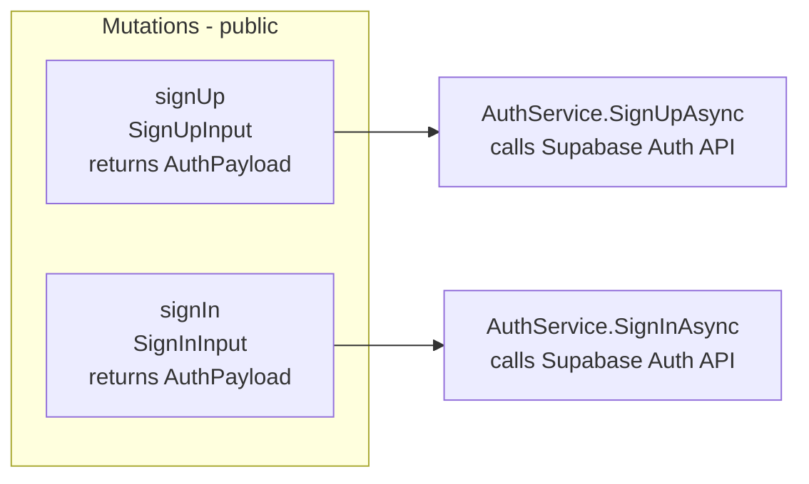

---

## Sign Up Flow

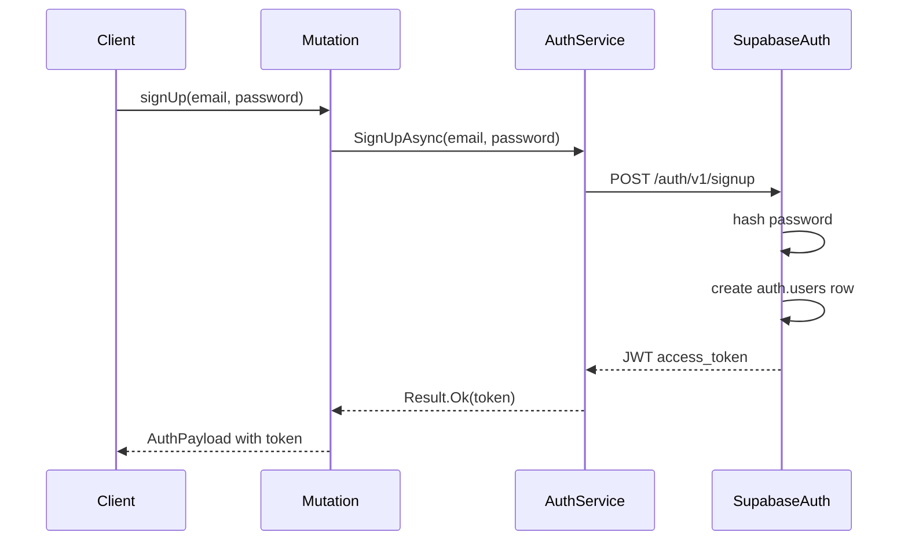

---

## Sign In Flow

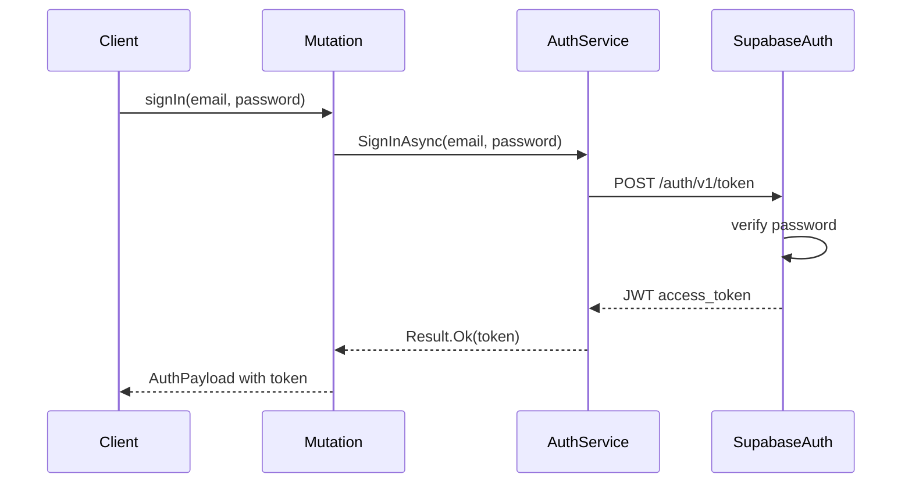

---

## Feature — Income

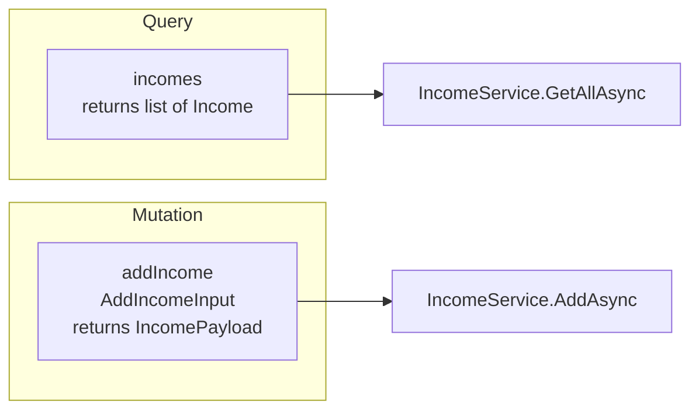

---

## Feature — Expenses

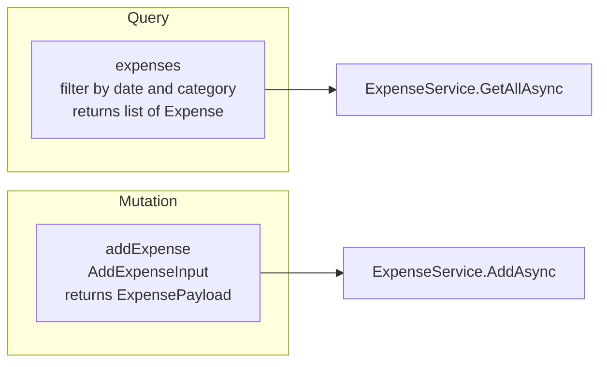

---

## Feature — Savings Goals

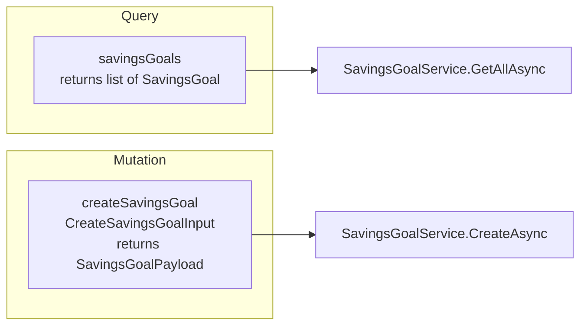

---

## Feature — Loans

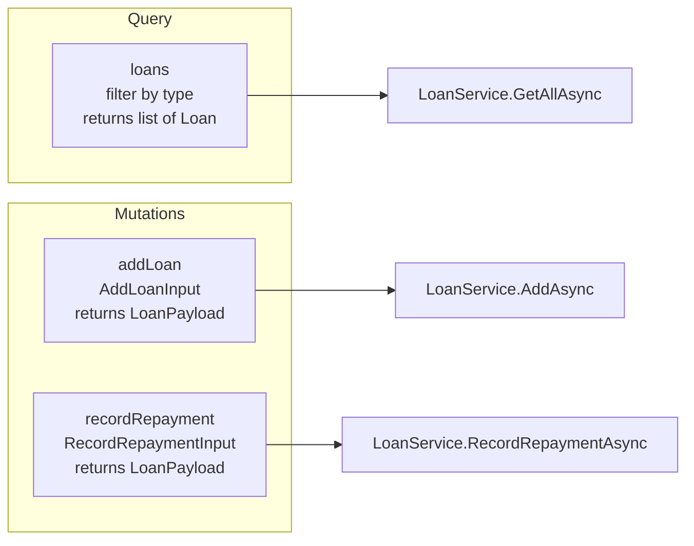

---

## Feature — Dashboard

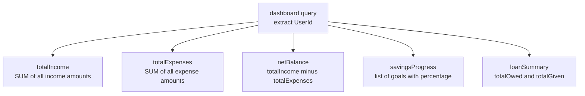

---

## Payload Shape

Every mutation returns a payload — never throws. Either data or an error is set, never both.

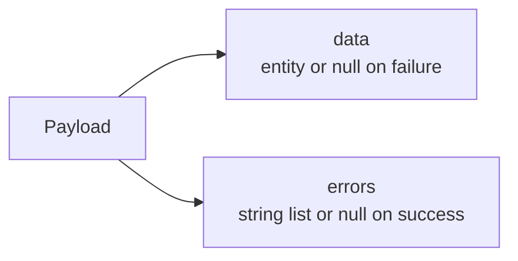

---

## Add Income — Full End-to-End Flow

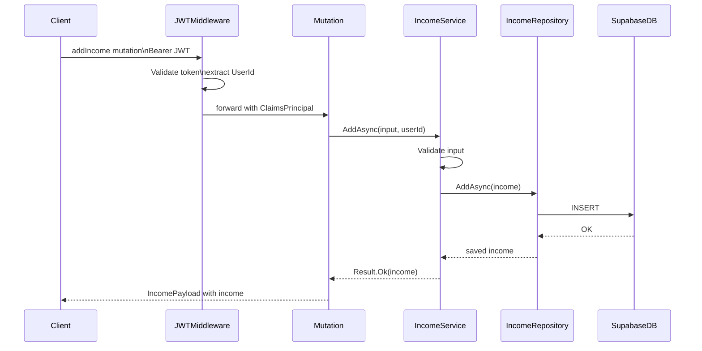

---

## Queries Reference

| Query | Auth | Returns |
|---|---|---|
| `health` | public | String |
| `incomes` | required | list of Income |
| `expenses` | required | list of Expense |
| `savingsGoals` | required | list of SavingsGoal |
| `loans` | required | list of Loan |
| `dashboard` | required | DashboardSummary |

---

## Mutations Reference

| Mutation | Auth | Input | Returns |
|---|---|---|---|
| `signUp` | public | `SignUpInput` | `AuthPayload` |
| `signIn` | public | `SignInInput` | `AuthPayload` |
| `addIncome` | required | `AddIncomeInput` | `IncomePayload` |
| `addExpense` | required | `AddExpenseInput` | `ExpensePayload` |
| `createSavingsGoal` | required | `CreateSavingsGoalInput` | `SavingsGoalPayload` |
| `addLoan` | required | `AddLoanInput` | `LoanPayload` |
| `recordRepayment` | required | `RecordRepaymentInput` | `LoanPayload` |

---

## SOLID and Design Rules

| Rule | How it applies |
|---|---|
| Single Responsibility | Resolvers only extract UserId and delegate to services |
| Dependency Inversion | Resolvers depend on service interfaces, not implementations |
| DRY | UserId extraction shared via a helper or base class |
| Open / Closed | New features add new resolver methods — existing ones unchanged |

---

## Exit Criteria

- All queries return data scoped to the authenticated user
- All mutations persist records and return the entity in the payload
- Unauthenticated requests to protected operations return `401`
- `health` query works without a token
- Dashboard returns correct aggregated totals
- `Result.Fail` from a service returns an error payload — never throws
