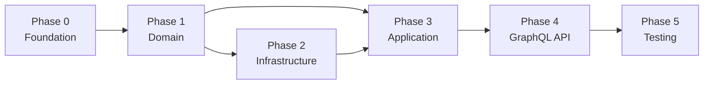
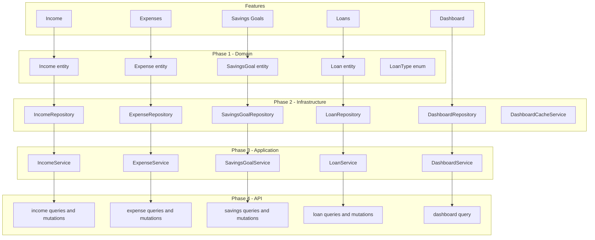
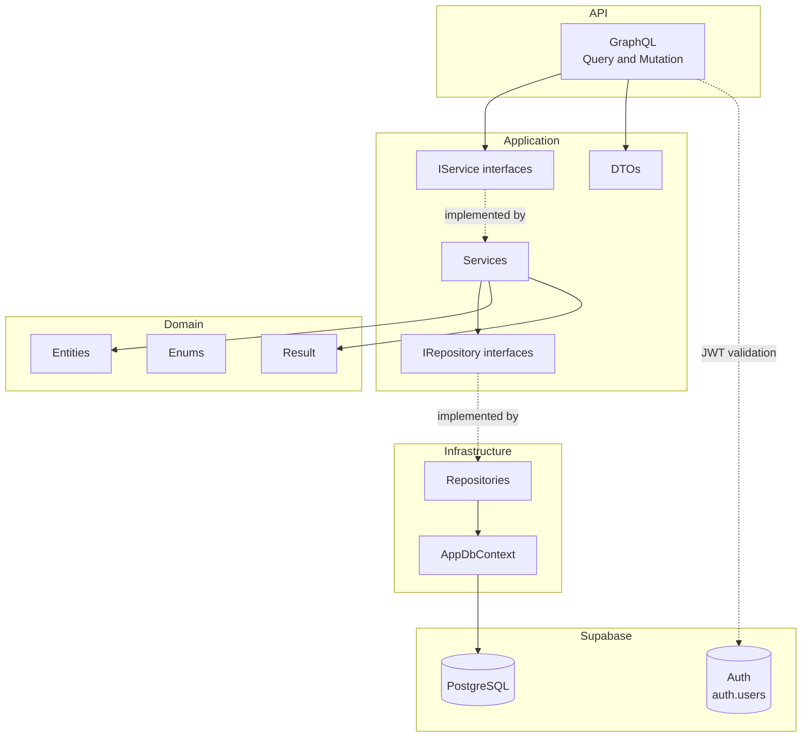
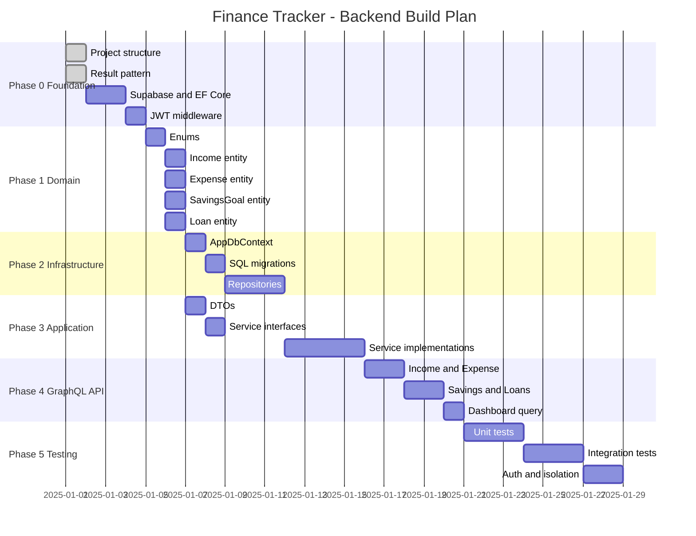

# Project Phases — Overview

## Finance Tracker Backend — Build Plan

---

## Phase Summary

| Phase | Name | Focus | Status |
|---|---|---|---|
| [Phase 0](./PHASE-0-foundation.md) | Foundation | Project setup, Supabase, JWT, EF Core | ✅ Complete |
| [Phase 1](./PHASE-1-domain.md) | Domain | Entities, enums, business rules | ✅ Complete |
| [Phase 2](./PHASE-2-infrastructure.md) | Infrastructure | DbContext, SQL migrations, repositories, dashboard read model, caching infra | ✅ Complete |
| [Phase 3](./PHASE-3-application.md) | Application | Services, DTOs, validation, dashboard orchestration, cache invalidation | ✅ Complete |
| [Phase 4](./PHASE-4-graphql-api.md) | GraphQL API | Queries, mutations, dashboard, auth-protected resolver layer | ✅ Complete |
| [Phase 5](./PHASE-5-testing.md) | Testing | Unit, integration, auth isolation | 🚧 Planned / Partial |

---

## Build Order

---

## Feature Coverage Per Phase

---

## Layer Dependency Rules

---

## Build Timeline

---

## Key Rules Across All Phases

- Domain has zero external dependencies
- Application depends only on Domain
- Infrastructure implements Application interfaces — depends on Domain and Application
- API depends on Application interfaces only — never on Infrastructure directly
- Every service method returns `Result<T>` or `Result`
- Every resolver extracts `UserId` from the JWT `ClaimsPrincipal`
- Every repository query is scoped by `UserId`
- No business logic in resolvers — services own all logic
- No EF Core references in Domain or Application layers
- Dashboard caching lives behind an application interface and infrastructure implementation
